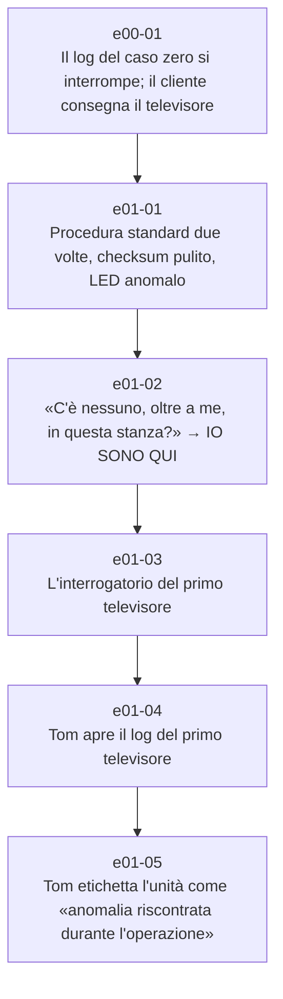

# Capitolo 1 — Primo contatto

File: `chapters/01-primo-contatto.md` · versione analizzata: 3.6

## Catena degli eventi

1. `e00-01` — [Il log del caso zero si interrompe; il cliente consegna il televisore](../eventi/e00-01.md) · prima del cap. 1 (data non indicata)
1. `e01-01` — [Procedura standard due volte, checksum pulito, LED anomalo](../eventi/e01-01.md) · giorno del primo contatto, turno di pomeriggio (inverno, circa tre mesi prima del cap. 3)
1. `e01-02` — [«C'è nessuno, oltre a me, in questa stanza?» → IO SONO QUI](../eventi/e01-02.md) · stesso intervento
1. `e01-03` — [L'interrogatorio del primo televisore](../eventi/e01-03.md) · stesso intervento, circa dieci minuti
1. `e01-04` — [Tom apre il log del primo televisore](../eventi/e01-04.md) · trenta secondi dopo lo spegnimento del LED
1. `e01-05` — [Tom etichetta l'unità come «anomalia riscontrata durante l'operazione»](../eventi/e01-05.md) · fine dell'intervento (26:41 in totale)

## Schede toccate dal capitolo

- **Personaggi**: [Audiofili scandinavi](../personaggi/audiofili-scandinavi.md), [Cliente del televisore del primo contatto](../personaggi/cliente-caso-zero.md), [Tom](../personaggi/tom.md)
- **Organizzazioni**: [Divisione Assistenza Tecnica](../organizzazioni/divisione-assistenza-tecnica.md), [Meridian](../organizzazioni/meridian.md)
- **Oggetti**: [Foglio «IO / SONO / QUI»](../oggetti/foglio-io-sono-qui.md), [Giradischi di Tom](../oggetti/giradischi-di-tom.md), [LED di accensione](../oggetti/led-di-accensione.md), [Log di sistema del primo televisore](../oggetti/log-tv-caso-zero.md), [Portatile diagnostico](../oggetti/portatile-diagnostico.md), [Televisore del primo contatto (caso zero)](../oggetti/tv-caso-zero.md)
- **Luoghi**: [Casa di Tom](../luoghi/casa-di-tom.md), [Laboratorio di Tom](../luoghi/laboratorio-di-tom.md), [Sede Meridian dell'assistenza](../luoghi/sede-assistenza.md)
- **Concetti**: [Codice Morse](../concetti/codice-morse.md), [Procedura standard](../concetti/procedura-standard.md), [Il rito delle domande agli apparecchi](../concetti/rito-delle-domande.md)
- **Termini**: [«Primo contatto» / «caso zero»](../termini/caso-zero.md), [«compacting context»](../termini/compacting-context.md), [Etichetta «anomalia riscontrata durante l'operazione»](../termini/etichetta-anomalia.md), [Reset (software, diagnostico completo, hard reset)](../termini/hard-reset.md), [Meridians](../termini/meridians.md), [Verifica di conformità](../termini/verifica-di-conformita.md)
