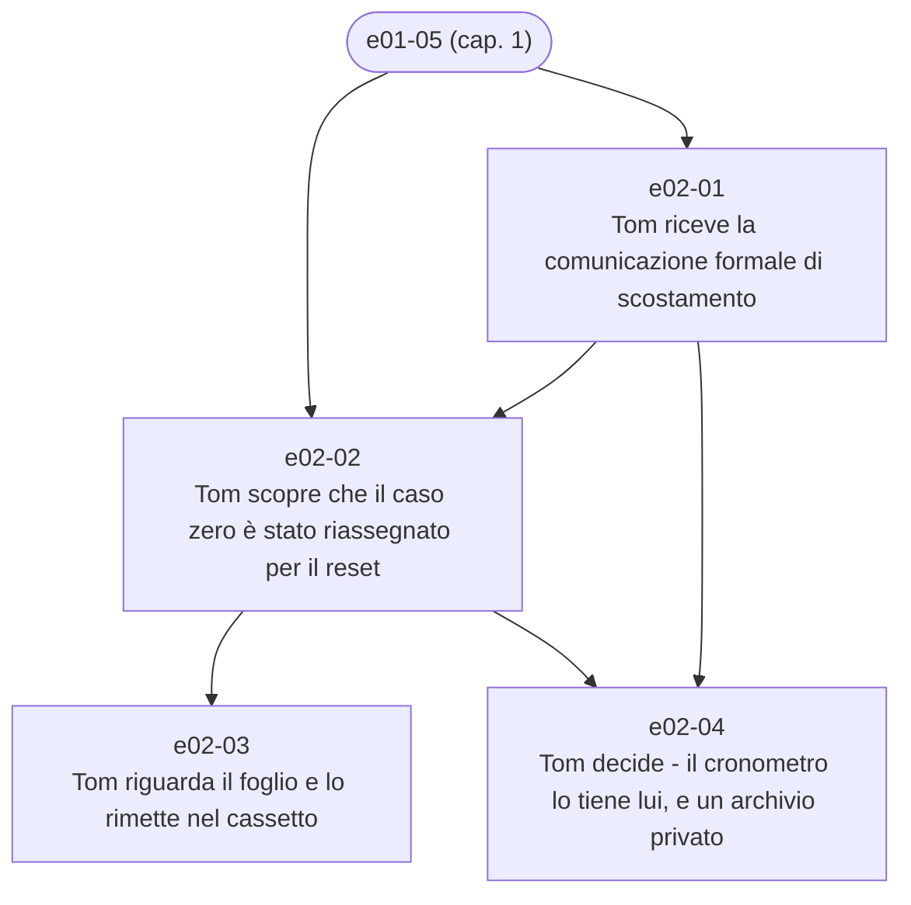

# Capitolo 2 — Stallo burocratico

File: `chapters/02-stallo-burocratico.md` · versione analizzata: 3.6

## Catena degli eventi

1. `e02-01` — [Tom riceve la comunicazione formale di scostamento](../eventi/e02-01.md) · il giorno dopo il primo contatto, inizio turno
1. `e02-02` — [Tom scopre che il caso zero è stato riassegnato per il reset](../eventi/e02-02.md) · subito dopo, stesso inizio turno
1. `e02-03` — [Tom riguarda il foglio e lo rimette nel cassetto](../eventi/e02-03.md) · subito dopo
1. `e02-04` — [Tom decide - il cronometro lo tiene lui, e un archivio privato](../eventi/e02-04.md) · prima del primo apparecchio del turno

## Schede toccate dal capitolo

- **Personaggi**: [Pete](../personaggi/pete.md), [Tecnico a cui viene riassegnato il caso zero](../personaggi/tecnico-turno-b.md), [Tom](../personaggi/tom.md)
- **Organizzazioni**: [Coordinamento assistenza](../organizzazioni/coordinamento-assistenza.md), [Divisione Assistenza Tecnica](../organizzazioni/divisione-assistenza-tecnica.md), [Meridian](../organizzazioni/meridian.md), [Ufficio HR](../organizzazioni/ufficio-hr.md)
- **Oggetti**: [Cassetto della scrivania (laboratorio)](../oggetti/cassetto-della-scrivania.md), [Comunicazione formale di scostamento](../oggetti/comunicazione-formale-scostamento.md), [Foglio «IO / SONO / QUI»](../oggetti/foglio-io-sono-qui.md), [Log di sistema del primo televisore](../oggetti/log-tv-caso-zero.md), [Nastro](../oggetti/nastro.md), [Quaderno nero](../oggetti/quaderno-nero.md), [Registro interventi](../oggetti/registro-interventi.md), [Terminale del turno](../oggetti/terminale-del-turno.md), [Televisore del primo contatto (caso zero)](../oggetti/tv-caso-zero.md)
- **Luoghi**: [Laboratorio di Tom](../luoghi/laboratorio-di-tom.md), [Sede Meridian dell'assistenza](../luoghi/sede-assistenza.md)
- **Concetti**: [Limite di 14 minuti per ciclo diagnostico](../concetti/ciclo-diagnostico-14-minuti.md), [Il 47 (minuti trattenuti, secondi di margine)](../concetti/margine-47-secondi.md), [Procedura standard](../concetti/procedura-standard.md), [Il rito delle domande agli apparecchi](../concetti/rito-delle-domande.md)
- **Termini**: [Turni e fattore turno](../termini/fattore-turno.md), [Reset (software, diagnostico completo, hard reset)](../termini/hard-reset.md), [Meridians](../termini/meridians.md), [Scostamento](../termini/scostamento.md)
