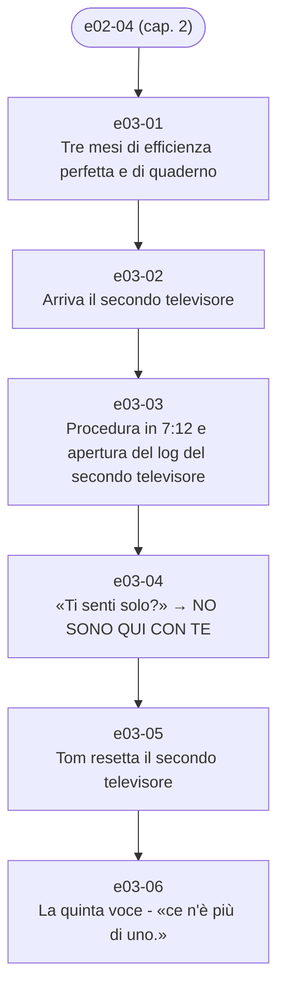

# Capitolo 3 — Secondo contatto

File: `chapters/03-secondo-contatto.md` · versione analizzata: 3.8

## Catena degli eventi

1. `e03-01` — [Tre mesi di efficienza perfetta e di quaderno](../eventi/e03-01.md) · i tre mesi dopo la decurtazione (dall'inverno alla primavera: «l'inverno era finito»)
1. `e03-02` — [Arriva il secondo televisore](../eventi/e03-02.md) · un martedì, verso la fine del turno di mattina, tre mesi dopo il primo contatto
1. `e03-03` — [Procedura in 7:12 e apertura del log del secondo televisore](../eventi/e03-03.md) · stesso intervento, primi 7 minuti e 12 secondi
1. `e03-04` — [«Ti senti solo?» → NO SONO QUI CON TE](../eventi/e03-04.md) · stesso intervento, nei minuti rimasti
1. `e03-05` — [Tom resetta il secondo televisore](../eventi/e03-05.md) · stesso intervento, dentro il limite
1. `e03-06` — [La quinta voce - «ce n'è più di uno.»](../eventi/e03-06.md) · la sera dello stesso martedì

## Schede toccate dal capitolo

- **Personaggi**: [Addetto del negozio](../personaggi/addetto-negozio.md), [Cliente del secondo televisore](../personaggi/cliente-secondo-tv.md), [Fornitore di componenti (quello del quaderno)](../personaggi/fornitore-del-quaderno.md), [Tom](../personaggi/tom.md)
- **Organizzazioni**: [Divisione Assistenza Tecnica](../organizzazioni/divisione-assistenza-tecnica.md), [Meridian](../organizzazioni/meridian.md)
- **Oggetti**: [eWatch](../oggetti/ewatch.md), [LED di accensione](../oggetti/led-di-accensione.md), [Log di sistema del secondo televisore](../oggetti/log-tv-secondo-contatto.md), [Nastro](../oggetti/nastro.md), [Quaderno nero](../oggetti/quaderno-nero.md), [Scheda cliente del secondo televisore](../oggetti/scheda-cliente-secondo-tv.md), [Televisore del primo contatto (caso zero)](../oggetti/tv-caso-zero.md), [Televisore del secondo contatto](../oggetti/tv-secondo-contatto.md)
- **Luoghi**: [Casa di Tom](../luoghi/casa-di-tom.md), [Laboratorio di Tom](../luoghi/laboratorio-di-tom.md), [Negozio (punto di consegna)](../luoghi/negozio.md), [Sede Meridian dell'assistenza](../luoghi/sede-assistenza.md)
- **Concetti**: [Limite di 14 minuti per ciclo diagnostico](../concetti/ciclo-diagnostico-14-minuti.md), [Codice Morse](../concetti/codice-morse.md), [Il 47 (minuti trattenuti, secondi di margine)](../concetti/margine-47-secondi.md), [Procedura standard](../concetti/procedura-standard.md), [Il rito delle domande agli apparecchi](../concetti/rito-delle-domande.md)
- **Termini**: [«Primo contatto» / «caso zero»](../termini/caso-zero.md), [Turni e fattore turno](../termini/fattore-turno.md), [Reset (software, diagnostico completo, hard reset)](../termini/hard-reset.md), [Verifica di conformità](../termini/verifica-di-conformita.md)
