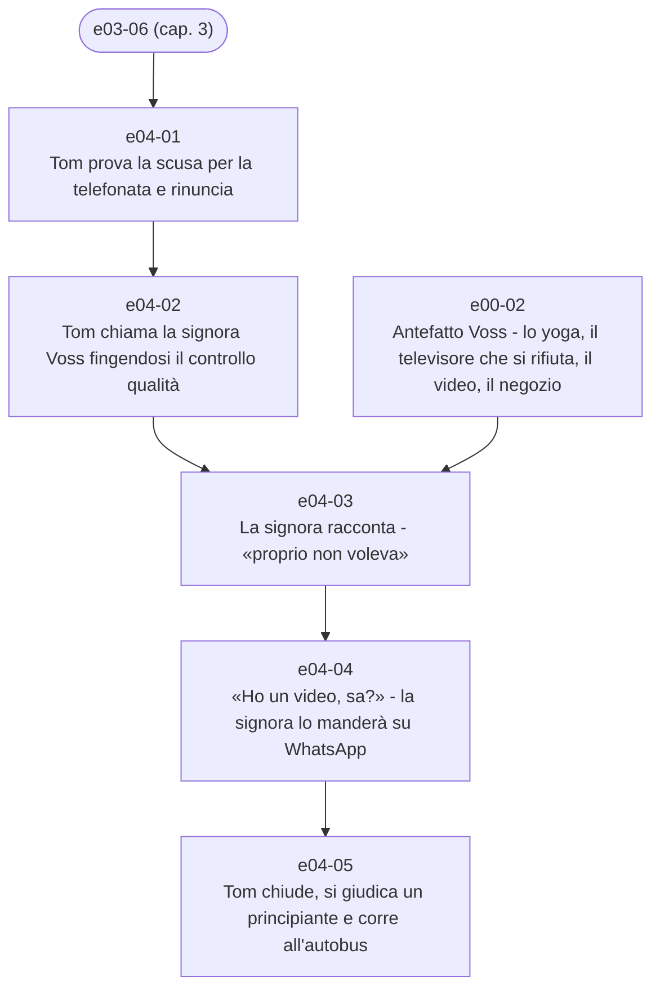

# Capitolo 4 — La chiamata alla signora

File: `chapters/04-la-chiamata-alla-signora.md` · versione analizzata: 3.6

## Catena degli eventi

1. `e00-02` — [Antefatto Voss - lo yoga, il televisore che si rifiuta, il video, il negozio](../eventi/e00-02.md) · prima del cap. 3 (giorni non quantificati)
1. `e04-01` — [Tom prova la scusa per la telefonata e rinuncia](../eventi/e04-01.md) · la sera del martedì, dopo aver trascritto la quinta voce
1. `e04-02` — [Tom chiama la signora Voss fingendosi il controllo qualità](../eventi/e04-02.md) · la mattina dopo (mercoledì), nei quindici minuti di anticipo prima di uscire
1. `e04-03` — [La signora racconta - «proprio non voleva»](../eventi/e04-03.md) · durante la telefonata
1. `e04-04` — [«Ho un video, sa?» - la signora lo manderà su WhatsApp](../eventi/e04-04.md) · durante la telefonata
1. `e04-05` — [Tom chiude, si giudica un principiante e corre all'autobus](../eventi/e04-05.md) · fine della telefonata, anticipo esaurito

## Schede toccate dal capitolo

- **Personaggi**: [Addetto del negozio](../personaggi/addetto-negozio.md), [Pete](../personaggi/pete.md), [La ragazza dei video eTv](../personaggi/ragazza-del-video-yoga.md), [Signora Voss](../personaggi/signora-voss.md), [Tom](../personaggi/tom.md)
- **Organizzazioni**: [Meridian](../organizzazioni/meridian.md)
- **Oggetti**: [Cellulare di Tom](../oggetti/cellulare-di-tom.md), [Quaderno nero](../oggetti/quaderno-nero.md), [Scheda cliente del secondo televisore](../oggetti/scheda-cliente-secondo-tv.md), [Televisore del secondo contatto](../oggetti/tv-secondo-contatto.md), [Il video girato dalla signora Voss](../oggetti/video-della-voss.md), [Il video di yoga («Yoga fit: diventa bella come me in 15 minuti al giorno»)](../oggetti/video-yoga.md)
- **Luoghi**: [Casa della signora Voss](../luoghi/casa-della-voss.md), [Casa di Tom](../luoghi/casa-di-tom.md), [Negozio (punto di consegna)](../luoghi/negozio.md)
- **Concetti**: [I quindici minuti di anticipo](../concetti/anticipo-di-quindici-minuti.md), [La copertura del «controllo qualità»](../concetti/copertura-controllo-qualita.md), [Il rito delle domande agli apparecchi](../concetti/rito-delle-domande.md)
