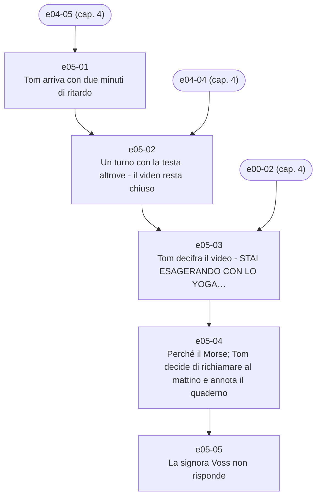

# Capitolo 5 — L'avvertimento

File: `chapters/05-lavvertimento.md` · versione analizzata: 3.7

## Catena degli eventi

1. `e05-01` — [Tom arriva con due minuti di ritardo](../eventi/e05-01.md) · mercoledì, inizio turno di mattina
1. `e05-02` — [Un turno con la testa altrove - il video resta chiuso](../eventi/e05-02.md) · mercoledì, durante il turno
1. `e05-03` — [Tom decifra il video - STAI ESAGERANDO CON LO YOGA…](../eventi/e05-03.md) · mercoledì sera, dopo cena
1. `e05-04` — [Perché il Morse; Tom decide di richiamare al mattino e annota il quaderno](../eventi/e05-04.md) · mercoledì, tarda sera (verso le undici)
1. `e05-05` — [La signora Voss non risponde](../eventi/e05-05.md) · giovedì mattina, nel quarto d'ora di anticipo

## Schede toccate dal capitolo

- **Personaggi**: [Pete](../personaggi/pete.md), [La ragazza del video di yoga](../personaggi/ragazza-del-video-yoga.md), [Signora Voss](../personaggi/signora-voss.md), [Tom](../personaggi/tom.md)
- **Oggetti**: [Cellulare di Tom](../oggetti/cellulare-di-tom.md), [Foglio con l'avvertimento decifrato](../oggetti/foglio-avvertimento.md), [LED di accensione](../oggetti/led-di-accensione.md), [Quaderno nero](../oggetti/quaderno-nero.md), [Tappetino da yoga della signora Voss](../oggetti/tappetino-da-yoga.md), [Televisore del secondo contatto](../oggetti/tv-secondo-contatto.md), [Il video girato dalla signora Voss](../oggetti/video-della-voss.md), [Il video di yoga della signora Voss](../oggetti/video-yoga.md)
- **Luoghi**: [Casa della signora Voss](../luoghi/casa-della-voss.md), [Casa di Tom](../luoghi/casa-di-tom.md), [Sede Meridian dell'assistenza](../luoghi/sede-assistenza.md)
- **Concetti**: [I quindici minuti di anticipo](../concetti/anticipo-di-quindici-minuti.md), [Codice Morse](../concetti/codice-morse.md), [La copertura del «controllo qualità»](../concetti/copertura-controllo-qualita.md), [Perché il LED - l'ipotesi del circuito di standby](../concetti/ipotesi-canale-standby.md), [Soglia dei cinque minuti di ritardo](../concetti/soglia-ritardo-cinque-minuti.md)
