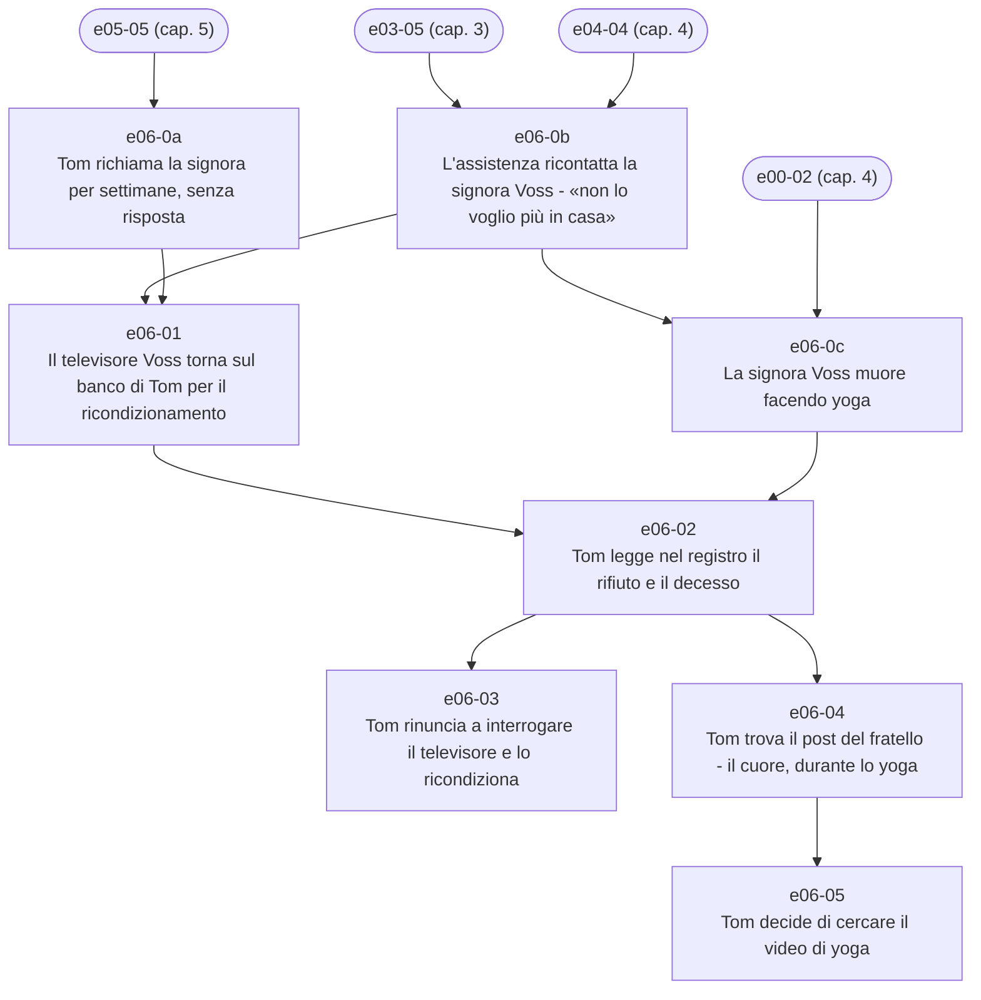

# Capitolo 6 — Il ricondizionamento

File: `chapters/06-il-ricondizionamento.md` · versione analizzata: 4.6

## Catena degli eventi

1. `e06-0a` — [Tom richiama la signora per settimane, senza risposta](../eventi/e06-0a.md) · dalle mattine successive al cap. 5 fino a tre settimane dopo
1. `e06-0b` — [L'assistenza ricontatta la signora Voss - «non lo voglio più in casa»](../eventi/e06-0b.md) · nelle tre settimane dopo il reset (data non indicata)
1. `e06-0c` — [La signora Voss muore facendo yoga](../eventi/e06-0c.md) · una mattina, dopo il rifiuto del ritiro; registrata «pochi giorni dopo» la prima voce
1. `e06-01` — [Il televisore Voss torna sul banco di Tom per il ricondizionamento](../eventi/e06-01.md) · poco più di tre settimane dopo il reset, durante il turno
1. `e06-02` — [Tom legge nel registro il rifiuto e il decesso](../eventi/e06-02.md) · stesso turno
1. `e06-03` — [Tom rinuncia a interrogare il televisore e lo ricondiziona](../eventi/e06-03.md) · stesso turno, entro la fine
1. `e06-04` — [Tom trova il post del fratello - il cuore, durante lo yoga](../eventi/e06-04.md) · la sera dello stesso giorno
1. `e06-05` — [Tom decide di cercare il video di yoga](../eventi/e06-05.md) · la stessa sera

## Schede toccate dal capitolo

- **Personaggi**: [Cliente del televisore del primo contatto](../personaggi/cliente-caso-zero.md), [Fratello della signora Voss](../personaggi/fratello-della-voss.md), [Signora Voss](../personaggi/signora-voss.md), [Tom](../personaggi/tom.md)
- **Oggetti**: [Carrello del ricondizionamento](../oggetti/carrello-del-ricondizionamento.md), [Cellulare di Tom](../oggetti/cellulare-di-tom.md), [eWatch](../oggetti/ewatch.md), [Post del fratello (con la foto della signora Voss)](../oggetti/post-del-fratello.md), [Quaderno nero](../oggetti/quaderno-nero.md), [Registro interventi](../oggetti/registro-interventi.md), [Televisore del primo contatto (caso zero)](../oggetti/tv-caso-zero.md), [Televisore del secondo contatto](../oggetti/tv-secondo-contatto.md), [Il video girato dalla signora Voss](../oggetti/video-della-voss.md), [Il video di yoga della signora Voss](../oggetti/video-yoga.md)
- **Luoghi**: [Casa della signora Voss](../luoghi/casa-della-voss.md), [Casa di Tom](../luoghi/casa-di-tom.md), [Laboratorio di Tom](../luoghi/laboratorio-di-tom.md)
- **Concetti**: [La copertura del «controllo qualità»](../concetti/copertura-controllo-qualita.md)
- **Termini**: [Reset (software, diagnostico completo, hard reset)](../termini/hard-reset.md), [Mantra](../termini/mantra.md), [Ricondizionamento (giacenza, rimborso, scorciatoia)](../termini/ricondizionamento.md)
