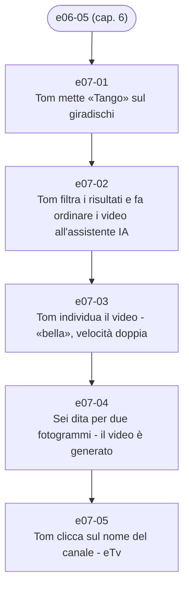

# Capitolo 7 — La ragazza con sei dita

File: `chapters/07-la-ragazza-con-sei-dita.md` · versione analizzata: 5.5

## Catena degli eventi

1. `e07-01` — [Tom mette «Tango» sul giradischi](../eventi/e07-01.md) · la stessa sera del cap. 6
1. `e07-02` — [Tom filtra i risultati e fa ordinare i video all'assistente IA](../eventi/e07-02.md) · la stessa sera
1. `e07-03` — [Tom individua il video - «bella», velocità doppia](../eventi/e07-03.md) · la stessa sera
1. `e07-04` — [Sei dita per due fotogrammi - il video è generato](../eventi/e07-04.md) · la stessa sera
1. `e07-05` — [Tom clicca sul nome del canale - eTv](../eventi/e07-05.md) · la stessa sera

## Schede toccate dal capitolo

- **Personaggi**: [Audiofili scandinavi](../personaggi/audiofili-scandinavi.md), [Mauro Vargiu (il trisavolo)](../personaggi/mauro-vargiu.md), [La ragazza dei video eTv](../personaggi/ragazza-del-video-yoga.md), [Signora Voss](../personaggi/signora-voss.md), [Tom](../personaggi/tom.md)
- **Oggetti**: [L'assistente IA di Tom](../oggetti/assistente-ia-di-tom.md), [Il canale eTv](../oggetti/canale-etv.md), [Cellulare di Tom](../oggetti/cellulare-di-tom.md), [Computer di Tom (a casa)](../oggetti/computer-di-tom.md), [Il disco «Tango» dei Matia Bazar](../oggetti/disco-tango.md), [Foglio con l'avvertimento decifrato](../oggetti/foglio-avvertimento.md), [Giradischi di Tom](../oggetti/giradischi-di-tom.md), [Post del fratello (con la foto della signora Voss)](../oggetti/post-del-fratello.md), [Il video di yoga («Yoga fit: diventa bella come me in 15 minuti al giorno»)](../oggetti/video-yoga.md)
- **Luoghi**: [Casa di Tom](../luoghi/casa-di-tom.md)
- **Termini**: [«Yoga fit»](../termini/yoga-fit.md)
