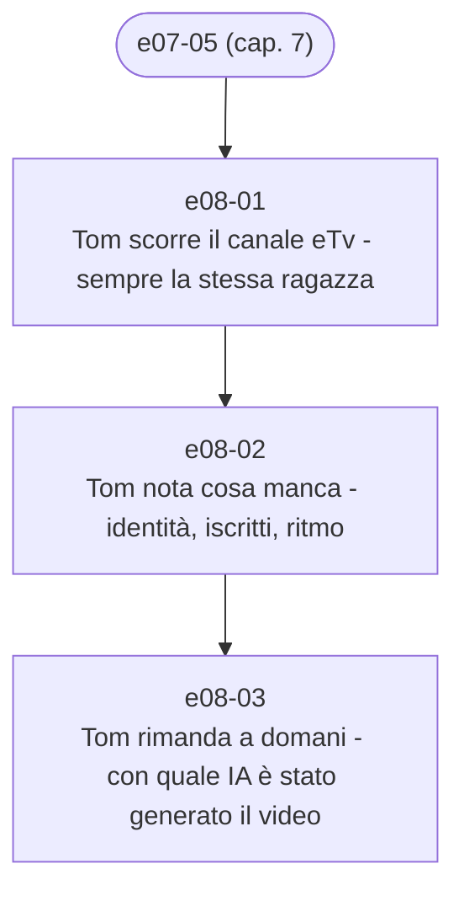

# Capitolo 8 — Il canale eTv

File: `chapters/08-il-canale-etv.md` · versione analizzata: 4.4

## Catena degli eventi

1. `e08-01` — [Tom scorre il canale eTv - sempre la stessa ragazza](../eventi/e08-01.md) · la stessa sera dei cap. 6-7
1. `e08-02` — [Tom nota cosa manca - identità, iscritti, ritmo](../eventi/e08-02.md) · la stessa sera
1. `e08-03` — [Tom rimanda a domani - con quale IA è stato generato il video](../eventi/e08-03.md) · la stessa sera, dopo le undici

## Schede toccate dal capitolo

- **Personaggi**: [La ragazza dei video eTv](../personaggi/ragazza-del-video-yoga.md), [Tom](../personaggi/tom.md)
- **Oggetti**: [Il canale eTv](../oggetti/canale-etv.md), [Computer di Tom (a casa)](../oggetti/computer-di-tom.md), [Il disco «Tango» dei Matia Bazar](../oggetti/disco-tango.md), [Giradischi di Tom](../oggetti/giradischi-di-tom.md), [Il video di yoga («Yoga fit: diventa bella come me in 15 minuti al giorno»)](../oggetti/video-yoga.md)
- **Luoghi**: [Casa di Tom](../luoghi/casa-di-tom.md)
