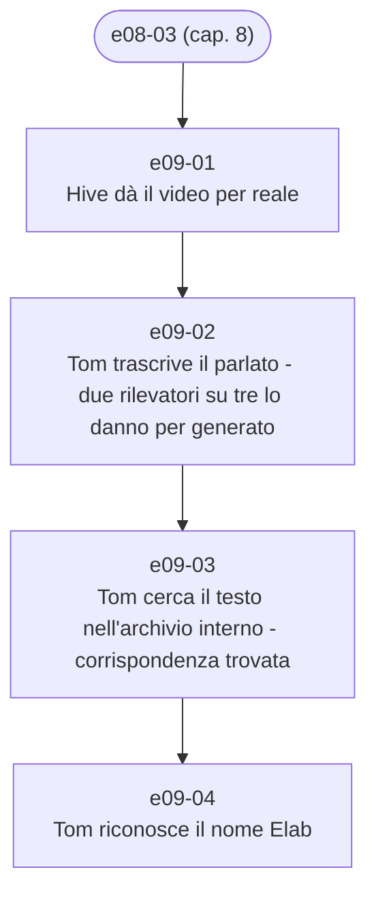

# Capitolo 9 — internal_unknown

File: `chapters/09-internal-unknown.md` · versione analizzata: 5.0

## Catena degli eventi

1. `e09-01` — [Hive dà il video per reale](../eventi/e09-01.md) · il mattino dopo, un'ora prima della sveglia solita, ancora buio
1. `e09-02` — [Tom trascrive il parlato - due rilevatori su tre lo danno per generato](../eventi/e09-02.md) · la stessa mattina, prima di uscire
1. `e09-03` — [Tom cerca il testo nell'archivio interno - corrispondenza trovata](../eventi/e09-03.md) · lo stesso giorno, ultima ora di turno
1. `e09-04` — [Tom riconosce il nome Elab](../eventi/e09-04.md) · subito dopo

## Schede toccate dal capitolo

- **Personaggi**: [La ragazza dei video eTv](../personaggi/ragazza-del-video-yoga.md), [Tom](../personaggi/tom.md)
- **Organizzazioni**: [Elab](../organizzazioni/elab.md), [Meridian](../organizzazioni/meridian.md)
- **Oggetti**: [Archivio interno di catalogazione degli artefatti](../oggetti/archivio-artefatti.md), [Il canale eTv](../oggetti/canale-etv.md), [Computer di Tom (a casa)](../oggetti/computer-di-tom.md), [elab@meridian.com](../oggetti/indirizzo-elab.md), [I rilevatori pubblici di IA (Hive Moderation, Undetectable AI, ZeroGPT)](../oggetti/rilevatori-ia.md), [Transcript del parlato del video di yoga](../oggetti/transcript-del-video.md), [Il video di yoga («Yoga fit: diventa bella come me in 15 minuti al giorno»)](../oggetti/video-yoga.md)
- **Luoghi**: [Casa di Tom](../luoghi/casa-di-tom.md), [Laboratorio di Tom](../luoghi/laboratorio-di-tom.md)
- **Concetti**: [I quindici minuti di anticipo](../concetti/anticipo-di-quindici-minuti.md), [L'ultima ora di turno](../concetti/ultima-ora-di-turno.md)
- **Termini**: [internal_unknown](../termini/internal-unknown.md), [«Origine non determinabile»](../termini/origine-non-determinabile.md)
