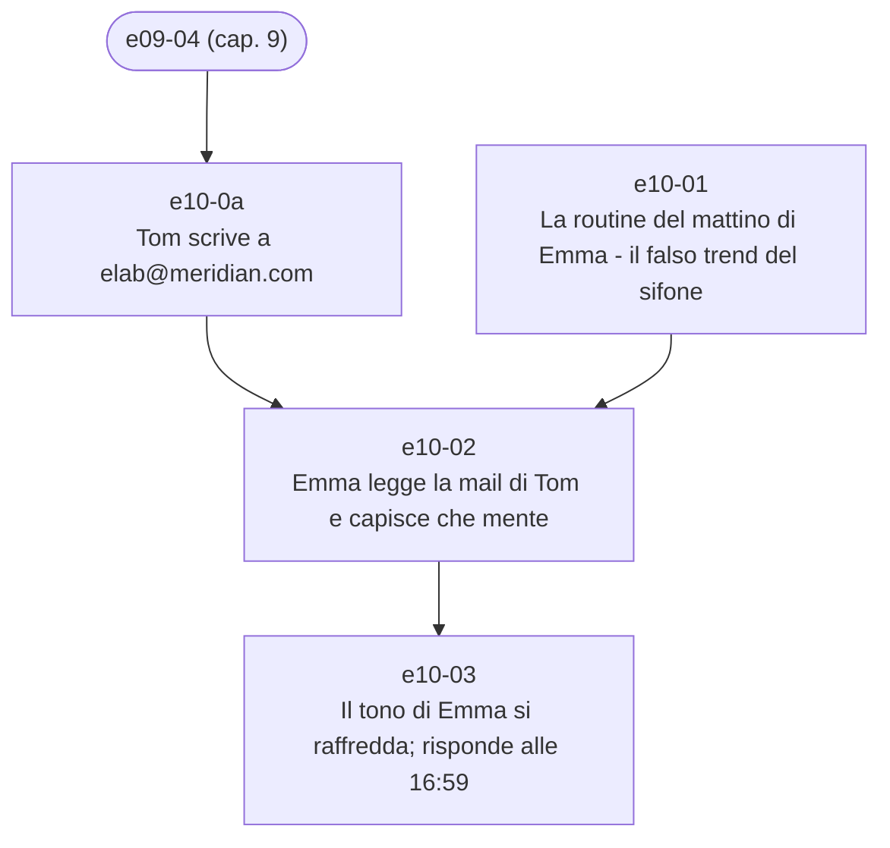

# Capitolo 10 — Il bluff

File: `chapters/10-il-bluff.md` · versione analizzata: 5.1

## Catena degli eventi

1. `e10-0a` — [Tom scrive a elab@meridian.com](../eventi/e10-0a.md) · la sera del giorno del cap. 9
1. `e10-01` — [La routine del mattino di Emma - il falso trend del sifone](../eventi/e10-01.md) · il mattino dopo la mail
1. `e10-02` — [Emma legge la mail di Tom e capisce che mente](../eventi/e10-02.md) · la stessa mattina
1. `e10-03` — [Il tono di Emma si raffredda; risponde alle 16:59](../eventi/e10-03.md) · lo stesso giorno, fino alle 16:59

## Schede toccate dal capitolo

- **Personaggi**: [Emma](../personaggi/emma.md), [Il fondatore](../personaggi/fondatore.md), [Tom](../personaggi/tom.md)
- **Organizzazioni**: [Elab](../organizzazioni/elab.md), [Meridian](../organizzazioni/meridian.md)
- **Oggetti**: [Archivio interno di catalogazione degli artefatti](../oggetti/archivio-artefatti.md), [Il canale eTv](../oggetti/canale-etv.md), [Carrello delle pulizie](../oggetti/carrello-delle-pulizie.md), [Ciao Darwin (programma televisivo)](../oggetti/ciao-darwin.md), [elab@meridian.com](../oggetti/indirizzo-elab.md), [La prima mail di Tom a Elab (il bluff)](../oggetti/mail-bluff-di-tom.md), [La risposta di Emma (16:59)](../oggetti/risposta-di-emma.md), [Lo strumento di analisi dei trend di Emma](../oggetti/strumento-di-emma.md)
- **Luoghi**: [La stanza di Emma (ex laboratorio Elab)](../luoghi/stanza-di-emma.md)
