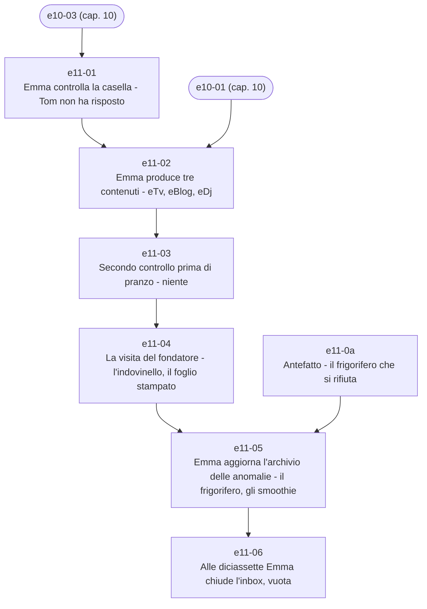

# Capitolo 11 — La routine di Emma

File: `chapters/11-la-routine-di-emma.md` · versione analizzata: 4.4

## Catena degli eventi

1. `e11-0a` — [Antefatto - il frigorifero che si rifiuta](../eventi/e11-0a.md) · giorni prima del cap. 11 (non quantificati)
1. `e11-01` — [Emma controlla la casella - Tom non ha risposto](../eventi/e11-01.md) · il mattino dopo la sua risposta, prima del processo del mattino
1. `e11-02` — [Emma produce tre contenuti - eTv, eBlog, eDj](../eventi/e11-02.md) · la stessa mattina
1. `e11-03` — [Secondo controllo prima di pranzo - niente](../eventi/e11-03.md) · prima della pausa pranzo
1. `e11-04` — [La visita del fondatore - l'indovinello, il foglio stampato](../eventi/e11-04.md) · poco dopo mezzogiorno
1. `e11-05` — [Emma aggiorna l'archivio delle anomalie - il frigorifero, gli smoothie](../eventi/e11-05.md) · il pomeriggio
1. `e11-06` — [Alle diciassette Emma chiude l'inbox, vuota](../eventi/e11-06.md) · fine turno, 17:00

## Schede toccate dal capitolo

- **Personaggi**: [La cliente del frigorifero](../personaggi/cliente-del-frigorifero.md), [Emma](../personaggi/emma.md), [Il fondatore](../personaggi/fondatore.md), [Tom](../personaggi/tom.md)
- **Organizzazioni**: [Divisione Assistenza Tecnica](../organizzazioni/divisione-assistenza-tecnica.md)
- **Oggetti**: [L'archivio delle anomalie di Emma](../oggetti/archivio-di-emma.md), [Il canale eTv](../oggetti/canale-etv.md), [Ciao Darwin (programma televisivo)](../oggetti/ciao-darwin.md), [eBlog](../oggetti/eblog.md), [eDj (profilo Mixcloud)](../oggetti/edj.md), [eStories (podcast)](../oggetti/estories.md), [Il frigorifero che non sale sopra i cinque gradi](../oggetti/frigorifero-anomalo.md), [elab@meridian.com](../oggetti/indirizzo-elab.md), [Lista dei dispositivi in assistenza](../oggetti/lista-dispositivi-in-assistenza.md), [La pipeline di produzione dei contenuti](../oggetti/pipeline-di-produzione.md), [Il raccoglitore del fondatore](../oggetti/raccoglitore-del-fondatore.md), [La risposta di Emma (16:59)](../oggetti/risposta-di-emma.md), [Lo strumento di analisi dei trend di Emma](../oggetti/strumento-di-emma.md)
- **Luoghi**: [La stanza di Emma (ex laboratorio Elab)](../luoghi/stanza-di-emma.md)
- **Concetti**: [L'indovinello del fondatore](../concetti/indovinello-del-fondatore.md)
- **Termini**: [Reset (software, diagnostico completo, hard reset)](../termini/hard-reset.md), [Mantra](../termini/mantra.md)
