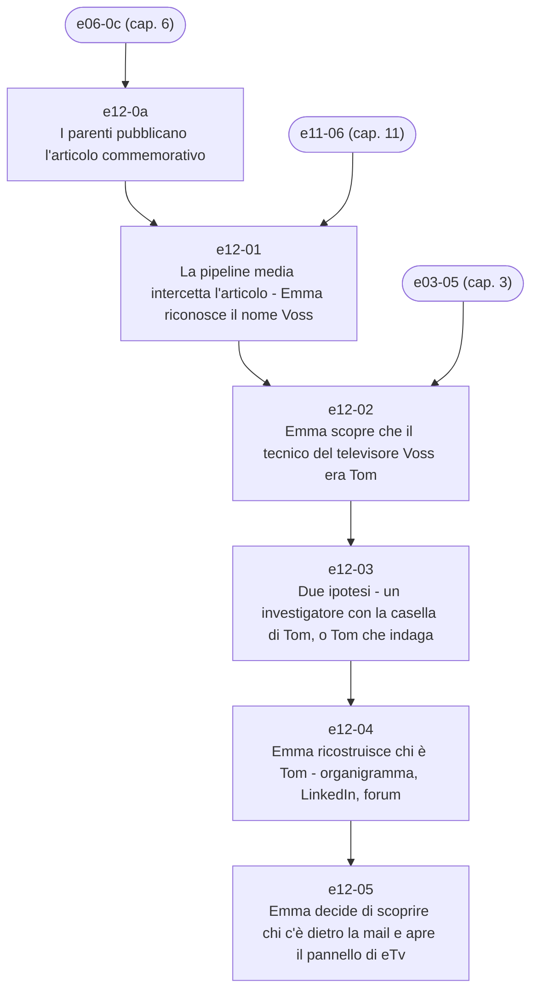

# Capitolo 12 — Solo un tecnico?

File: `chapters/12-solo-un-tecnico.md` · versione analizzata: 7.1

## Catena degli eventi

1. `e12-0a` — [I parenti pubblicano l'articolo commemorativo](../eventi/e12-0a.md) · il giorno prima del cap. 12
1. `e12-01` — [La pipeline media intercetta l'articolo - Emma riconosce il nome Voss](../eventi/e12-01.md) · il mattino, tre giorni dopo la mail di Tom
1. `e12-02` — [Emma scopre che il tecnico del televisore Voss era Tom](../eventi/e12-02.md) · la stessa mattina
1. `e12-03` — [Due ipotesi - un investigatore con la casella di Tom, o Tom che indaga](../eventi/e12-03.md) · la stessa mattina
1. `e12-04` — [Emma ricostruisce chi è Tom - organigramma, LinkedIn, forum](../eventi/e12-04.md) · la stessa mattina
1. `e12-05` — [Emma decide di scoprire chi c'è dietro la mail e apre il pannello di eTv](../eventi/e12-05.md) · la stessa mattina

## Schede toccate dal capitolo

- **Personaggi**: [Audiofili scandinavi](../personaggi/audiofili-scandinavi.md), [Emma](../personaggi/emma.md), [Signora Voss](../personaggi/signora-voss.md), [Tom](../personaggi/tom.md)
- **Oggetti**: [L'archivio delle anomalie di Emma](../oggetti/archivio-di-emma.md), [L'articolo commemorativo sulla signora Voss](../oggetti/articolo-commemorativo-voss.md), [Il canale eTv](../oggetti/canale-etv.md), [eWatch](../oggetti/ewatch.md), [Giradischi di Tom](../oggetti/giradischi-di-tom.md), [Lista dei dispositivi in assistenza](../oggetti/lista-dispositivi-in-assistenza.md), [La prima mail di Tom a Elab (il bluff)](../oggetti/mail-bluff-di-tom.md), [Organigramma e pagina aziendale di Tom](../oggetti/organigramma.md), [Il pannello di eTv](../oggetti/pannello-di-etv.md), [La pipeline di sorveglianza dei media](../oggetti/pipeline-media.md), [Post del fratello (con la foto della signora Voss)](../oggetti/post-del-fratello.md), [La risposta di Emma (16:59)](../oggetti/risposta-di-emma.md), [Il sito e il forum del progetto del giradischi](../oggetti/sito-del-giradischi.md), [Tappetino da yoga della signora Voss](../oggetti/tappetino-da-yoga.md), [Televisore del secondo contatto](../oggetti/tv-secondo-contatto.md)
