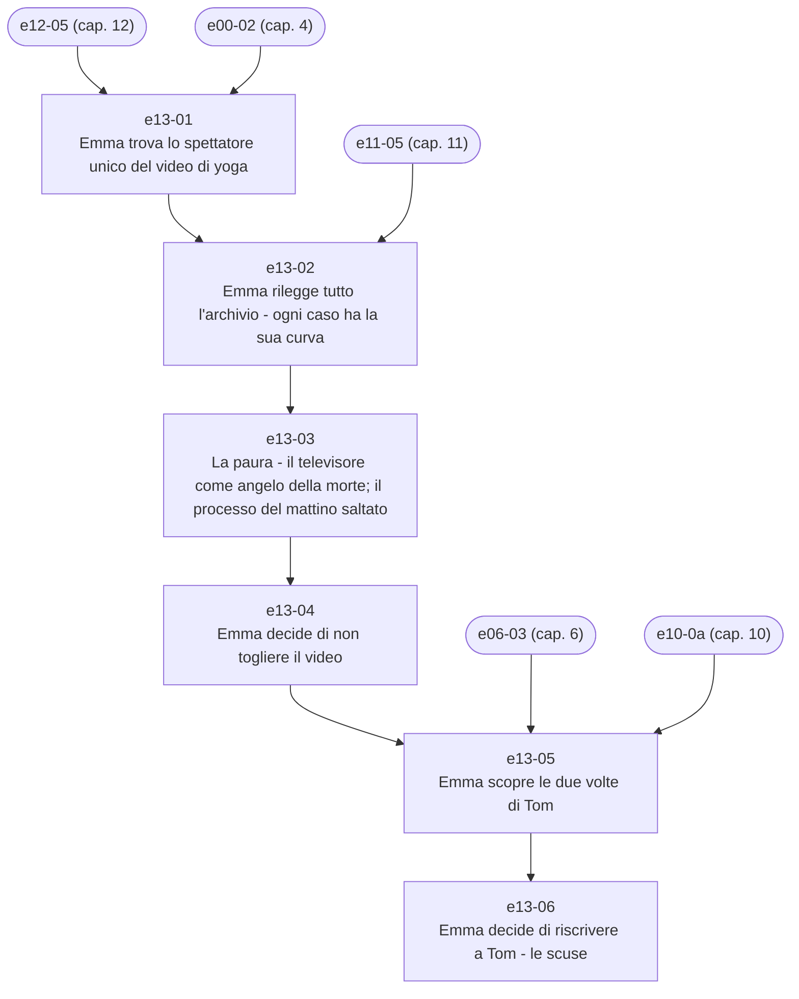

# Capitolo 13 — La correlazione

File: `chapters/13-la-correlazione.md` · versione analizzata: 3.0

## Catena degli eventi

1. `e13-01` — [Emma trova lo spettatore unico del video di yoga](../eventi/e13-01.md) · la stessa mattina del cap. 12
1. `e13-02` — [Emma rilegge tutto l'archivio - ogni caso ha la sua curva](../eventi/e13-02.md) · la stessa mattina
1. `e13-03` — [La paura - il televisore come angelo della morte; il processo del mattino saltato](../eventi/e13-03.md) · la stessa mattina, fino alle dieci passate
1. `e13-04` — [Emma decide di non togliere il video](../eventi/e13-04.md) · la stessa mattina
1. `e13-05` — [Emma scopre le due volte di Tom](../eventi/e13-05.md) · la stessa mattina
1. `e13-06` — [Emma decide di riscrivere a Tom - le scuse](../eventi/e13-06.md) · le dieci e mezza

## Schede toccate dal capitolo

- **Personaggi**: [Emma](../personaggi/emma.md), [Signora Voss](../personaggi/signora-voss.md), [Tom](../personaggi/tom.md)
- **Oggetti**: [L'archivio delle anomalie di Emma](../oggetti/archivio-di-emma.md), [L'articolo commemorativo sulla signora Voss](../oggetti/articolo-commemorativo-voss.md), [Il canale eTv](../oggetti/canale-etv.md), [Il carrello del caffè delle dieci](../oggetti/carrello-del-caffe.md), [Il frigorifero che non sale sopra i cinque gradi](../oggetti/frigorifero-anomalo.md), [Lista dei dispositivi in assistenza](../oggetti/lista-dispositivi-in-assistenza.md), [La prima mail di Tom a Elab (il bluff)](../oggetti/mail-bluff-di-tom.md), [La seconda mail di Emma (le scuse)](../oggetti/mail-di-scuse-di-emma.md), [Il pannello di eTv](../oggetti/pannello-di-etv.md), [Registro interventi](../oggetti/registro-interventi.md), [La risposta di Emma (16:59)](../oggetti/risposta-di-emma.md), [Tappetino da yoga della signora Voss](../oggetti/tappetino-da-yoga.md), [Televisore del secondo contatto](../oggetti/tv-secondo-contatto.md), [Il video di yoga («Yoga fit: diventa bella come me in 15 minuti al giorno»)](../oggetti/video-yoga.md)
- **Luoghi**: [La stanza di Emma (ex laboratorio Elab)](../luoghi/stanza-di-emma.md)
- **Concetti**: [Il meccanismo - la stessa cosa ripetuta finché non c'è più spazio](../concetti/meccanismo-della-ripetizione.md)
- **Termini**: [«Angelo della morte»](../termini/angelo-della-morte.md), [Ricondizionamento (giacenza, rimborso, scorciatoia)](../termini/ricondizionamento.md)
