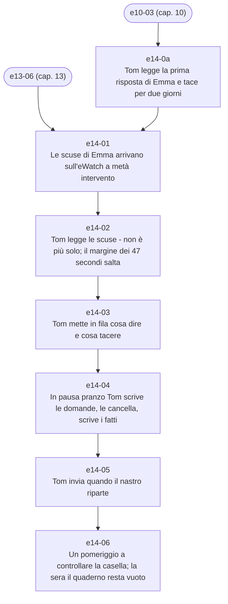

# Capitolo 14 — La fiducia di Tom

File: `chapters/14-la-fiducia-di-tom.md` · versione analizzata: 3.0

## Catena degli eventi

1. `e14-0a` — [Tom legge la prima risposta di Emma e tace per due giorni](../eventi/e14-0a.md) · fine turno del giorno del cap. 10; poi le due mattine successive
1. `e14-01` — [Le scuse di Emma arrivano sull'eWatch a metà intervento](../eventi/e14-01.md) · stesso giorno dei cap. 12-13, turno del mattino, dopo le dieci e mezza
1. `e14-02` — [Tom legge le scuse - non è più solo; il margine dei 47 secondi salta](../eventi/e14-02.md) · nei quasi cinque minuti rimasti dello slot
1. `e14-03` — [Tom mette in fila cosa dire e cosa tacere](../eventi/e14-03.md) · il resto della mattina
1. `e14-04` — [In pausa pranzo Tom scrive le domande, le cancella, scrive i fatti](../eventi/e14-04.md) · pausa pranzo
1. `e14-05` — [Tom invia quando il nastro riparte](../eventi/e14-05.md) · fine della pausa pranzo
1. `e14-06` — [Un pomeriggio a controllare la casella; la sera il quaderno resta vuoto](../eventi/e14-06.md) · pomeriggio e sera dello stesso giorno

## Schede toccate dal capitolo

- **Personaggi**: [Emma](../personaggi/emma.md), [Pete](../personaggi/pete.md), [Signora Voss](../personaggi/signora-voss.md), [Tom](../personaggi/tom.md)
- **Organizzazioni**: [Elab](../organizzazioni/elab.md)
- **Oggetti**: [Gli apparecchi ordinari del cap. 14](../oggetti/apparecchi-ordinari.md), [Il canale eTv](../oggetti/canale-etv.md), [eWatch](../oggetti/ewatch.md), [elab@meridian.com](../oggetti/indirizzo-elab.md), [La seconda mail di Emma (le scuse)](../oggetti/mail-di-scuse-di-emma.md), [Nastro](../oggetti/nastro.md), [Quaderno nero](../oggetti/quaderno-nero.md), [Registro interventi](../oggetti/registro-interventi.md), [La risposta di Emma (16:59)](../oggetti/risposta-di-emma.md), [La risposta di Tom a Emma (solo fatti)](../oggetti/risposta-di-tom.md), [Terminale del turno](../oggetti/terminale-del-turno.md), [Televisore del secondo contatto](../oggetti/tv-secondo-contatto.md), [Il video girato dalla signora Voss](../oggetti/video-della-voss.md)
- **Luoghi**: [Laboratorio di Tom](../luoghi/laboratorio-di-tom.md), [La mensa](../luoghi/mensa.md), [Sede Meridian dell'assistenza](../luoghi/sede-assistenza.md)
- **Concetti**: [Limite di 14 minuti per ciclo diagnostico](../concetti/ciclo-diagnostico-14-minuti.md), [Il digiuno intermittente di Tom](../concetti/digiuno-intermittente.md), [Il 47 (minuti trattenuti, secondi di margine)](../concetti/margine-47-secondi.md), [Le regole (scritte e non) su posta e pausa](../concetti/regole-sulla-posta.md), [Il rito delle domande agli apparecchi](../concetti/rito-delle-domande.md)
- **Termini**: [Turni e fattore turno](../termini/fattore-turno.md)
