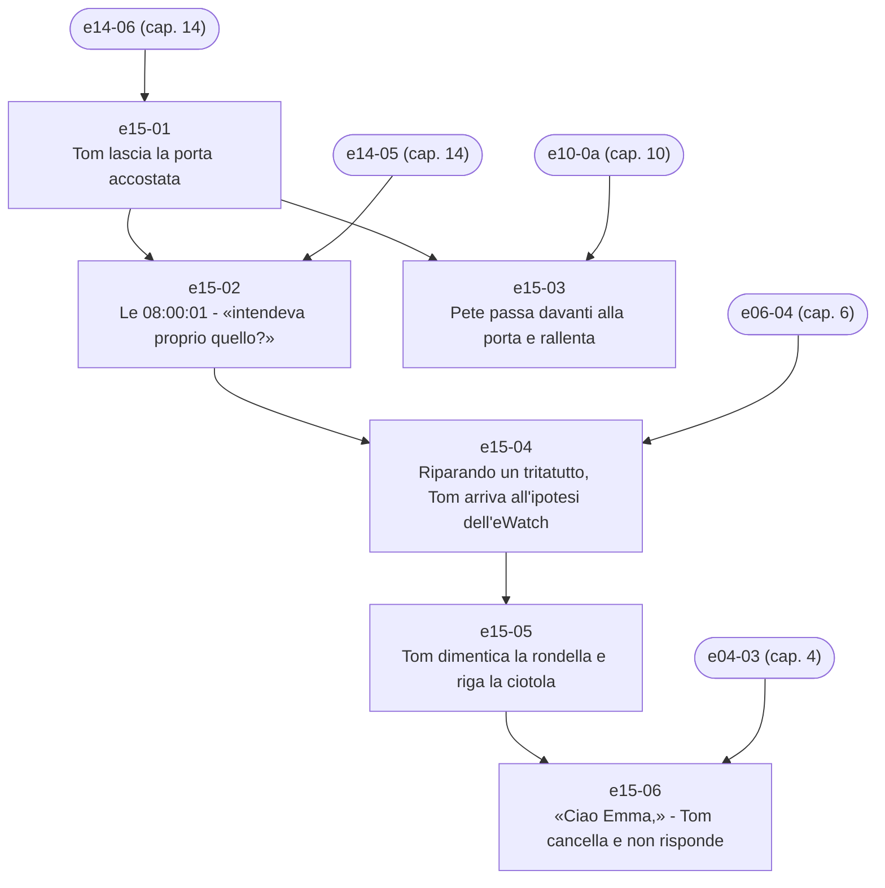

# Capitolo 15 — Le 08:00:01

File: `chapters/15-le-0800-01.md` · versione analizzata: 3.0

## Catena degli eventi

1. `e15-01` — [Tom lascia la porta accostata](../eventi/e15-01.md) · il mattino dopo, alle otto meno un quarto
1. `e15-02` — [Le 08:00:01 - «intendeva proprio quello?»](../eventi/e15-02.md) · alle 08:00:01
1. `e15-03` — [Pete passa davanti alla porta e rallenta](../eventi/e15-03.md) · subito dopo
1. `e15-04` — [Riparando un tritatutto, Tom arriva all'ipotesi dell'eWatch](../eventi/e15-04.md) · primo intervento del turno
1. `e15-05` — [Tom dimentica la rondella e riga la ciotola](../eventi/e15-05.md) · stesso intervento
1. `e15-06` — [«Ciao Emma,» - Tom cancella e non risponde](../eventi/e15-06.md) · nei secondi prima del pezzo successivo

## Schede toccate dal capitolo

- **Personaggi**: [Addetto del negozio](../personaggi/addetto-negozio.md), [Emma](../personaggi/emma.md), [Pete](../personaggi/pete.md), [Signora Voss](../personaggi/signora-voss.md), [Tom](../personaggi/tom.md)
- **Oggetti**: [eWatch](../oggetti/ewatch.md), [Nastro](../oggetti/nastro.md), [Post del fratello (con la foto della signora Voss)](../oggetti/post-del-fratello.md), [Quaderno nero](../oggetti/quaderno-nero.md), [La risposta di Tom a Emma (solo fatti)](../oggetti/risposta-di-tom.md), [Scheda cliente del secondo televisore](../oggetti/scheda-cliente-secondo-tv.md), [Terminale del turno](../oggetti/terminale-del-turno.md), [La mail delle 08:00:01](../oggetti/terza-mail-di-emma.md), [Il tritatutto con la ciotola rigata](../oggetti/tritatutto.md), [Televisore del secondo contatto](../oggetti/tv-secondo-contatto.md)
- **Luoghi**: [Laboratorio di Tom](../luoghi/laboratorio-di-tom.md), [Sede Meridian dell'assistenza](../luoghi/sede-assistenza.md)
- **Concetti**: [I quindici minuti di anticipo](../concetti/anticipo-di-quindici-minuti.md), [Limite di 14 minuti per ciclo diagnostico](../concetti/ciclo-diagnostico-14-minuti.md), [Come il televisore sapeva del cuore - l'ipotesi dell'eWatch](../concetti/ipotesi-ewatch.md), [Il 47 (minuti trattenuti, secondi di margine)](../concetti/margine-47-secondi.md), [La porta accostata](../concetti/porta-accostata.md), [Le regole (scritte e non) su posta e pausa](../concetti/regole-sulla-posta.md)
- **Termini**: [Verifica di conformità](../termini/verifica-di-conformita.md)
