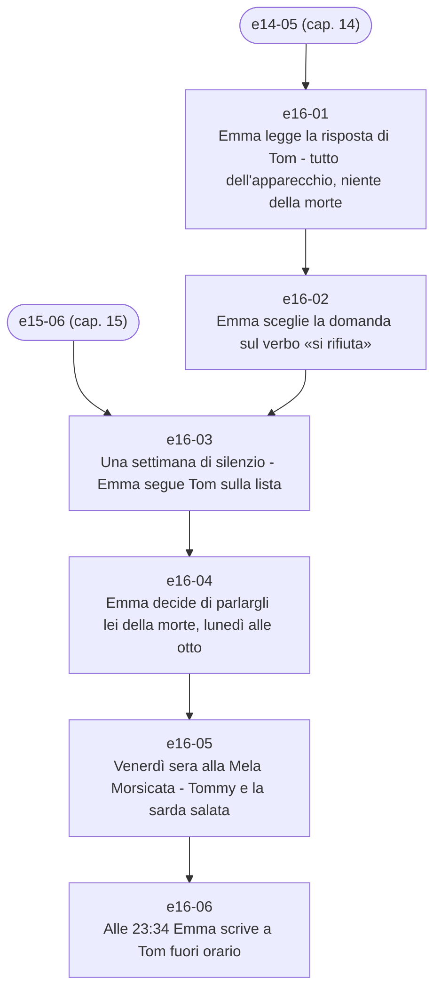

# Capitolo 16 — Le 23:34 di venerdì

File: `chapters/16-le-2334-di-venerdi.md` · versione analizzata: 5.23

## Catena degli eventi

1. `e16-01` — [Emma legge la risposta di Tom - tutto dell'apparecchio, niente della morte](../eventi/e16-01.md) · venerdì, poco dopo l'una e mezza (stesso giorno dei cap. 12-14)
1. `e16-02` — [Emma sceglie la domanda sul verbo «si rifiuta»](../eventi/e16-02.md) · venerdì pomeriggio e sera
1. `e16-03` — [Una settimana di silenzio - Emma segue Tom sulla lista](../eventi/e16-03.md) · da sabato a giovedì
1. `e16-04` — [Emma decide di parlargli lei della morte, lunedì alle otto](../eventi/e16-04.md) · giovedì; venerdì alle cinque la casella è vuota da sei giorni
1. `e16-05` — [Venerdì sera alla Mela Morsicata - Tommy e la sarda salata](../eventi/e16-05.md) · venerdì sera, una settimana dopo
1. `e16-06` — [Alle 23:34 Emma scrive a Tom fuori orario](../eventi/e16-06.md) · venerdì, 23:34

## Schede toccate dal capitolo

- **Personaggi**: [Il cameriere della Mela Morsicata](../personaggi/cameriere-della-mela.md), [Emma](../personaggi/emma.md), [Helge Mandelbrot](../personaggi/helge-mandelbrot.md), [Pete](../personaggi/pete.md), [Tom](../personaggi/tom.md), [«Tommy»](../personaggi/tommy.md)
- **Organizzazioni**: [Meridian](../organizzazioni/meridian.md)
- **Oggetti**: [Gli apparecchi ordinari del cap. 14](../oggetti/apparecchi-ordinari.md), [elab@meridian.com](../oggetti/indirizzo-elab.md), [Lista dei dispositivi in assistenza](../oggetti/lista-dispositivi-in-assistenza.md), [La mail delle 23:34 di venerdì](../oggetti/mail-delle-2334.md), [La seconda mail di Emma (le scuse)](../oggetti/mail-di-scuse-di-emma.md), [La newsletter di Benessere Meridian (modalità presenza)](../oggetti/newsletter-benessere.md), [Registro interventi](../oggetti/registro-interventi.md), [La risposta di Tom a Emma (solo fatti)](../oggetti/risposta-di-tom.md), [La mail delle 08:00:01](../oggetti/terza-mail-di-emma.md), [Televisore del secondo contatto](../oggetti/tv-secondo-contatto.md)
- **Luoghi**: [La Mela Morsicata](../luoghi/la-mela-morsicata.md), [La stanza di Emma (ex laboratorio Elab)](../luoghi/stanza-di-emma.md)
- **Concetti**: [Calendario ricostruito (giorni della settimana)](../concetti/calendario.md), [Le regole (scritte e non) su posta e pausa](../concetti/regole-sulla-posta.md), [Il sofisma della sarda salata](../concetti/sofisma-della-sarda-salata.md)
- **Termini**: [Modalità presenza](../termini/modalita-presenza.md)
