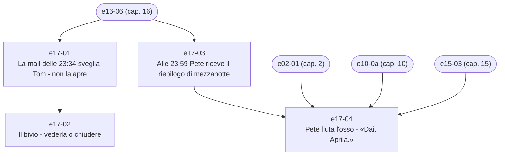

# Capitolo 17 — Il bivio

File: `chapters/17-il-bivio.md` · versione analizzata: 1.18

## Catena degli eventi

1. `e17-01` — [La mail delle 23:34 sveglia Tom - non la apre](../eventi/e17-01.md) · venerdì, 23:34
1. `e17-02` — [Il bivio - vederla o chiudere](../eventi/e17-02.md) · subito dopo
1. `e17-03` — [Alle 23:59 Pete riceve il riepilogo di mezzanotte](../eventi/e17-03.md) · venerdì, 23:59
1. `e17-04` — [Pete fiuta l'osso - «Dai. Aprila.»](../eventi/e17-04.md) · dopo le 23:59

## Schede toccate dal capitolo

- **Personaggi**: [Emma](../personaggi/emma.md), [Pete](../personaggi/pete.md), [Tom](../personaggi/tom.md)
- **Organizzazioni**: [Gli ispettori interni](../organizzazioni/ispettori-interni.md), [Meridian](../organizzazioni/meridian.md)
- **Oggetti**: [Ciao Darwin (programma televisivo)](../oggetti/ciao-darwin.md), [Computer di Tom (a casa)](../oggetti/computer-di-tom.md), [Comunicazione formale di scostamento](../oggetti/comunicazione-formale-scostamento.md), [eWatch](../oggetti/ewatch.md), [La prima mail di Tom a Elab (il bluff)](../oggetti/mail-bluff-di-tom.md), [La mail delle 23:34 di venerdì](../oggetti/mail-delle-2334.md), [Il riepilogo di mezzanotte](../oggetti/riepilogo-di-mezzanotte.md)
- **Luoghi**: [Casa di Pete](../luoghi/casa-di-pete.md), [Casa di Tom](../luoghi/casa-di-tom.md)
- **Concetti**: [Il bivio](../concetti/il-bivio.md), [La porta accostata](../concetti/porta-accostata.md), [Le regole (scritte e non) su posta e pausa](../concetti/regole-sulla-posta.md)
- **Termini**: [Smutandata](../termini/smutandata.md), [Tabella di Conversione (di Pete)](../termini/tabella-di-conversione.md)
