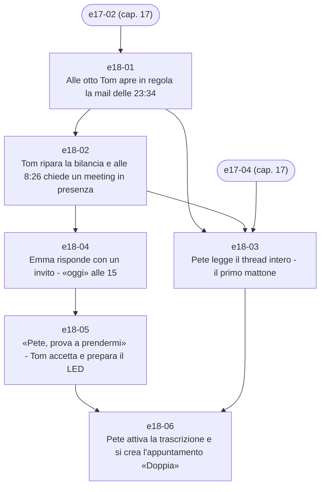

# Capitolo 18 — La richiesta di meeting

File: `chapters/18-la-richiesta-di-meeting.md` · versione analizzata: 5.5

## Catena degli eventi

1. `e18-01` — [Alle otto Tom apre in regola la mail delle 23:34](../eventi/e18-01.md) · sabato, 8:00
1. `e18-02` — [Tom ripara la bilancia e alle 8:26 chiede un meeting in presenza](../eventi/e18-02.md) · sabato, 8:00-8:26
1. `e18-03` — [Pete legge il thread intero - il primo mattone](../eventi/e18-03.md) · sabato, dalle 8:01 alle 8:26 e oltre
1. `e18-04` — [Emma risponde con un invito - «oggi» alle 15](../eventi/e18-04.md) · sabato, dalle 8:26 alle 10:00
1. `e18-05` — [«Pete, prova a prendermi» - Tom accetta e prepara il LED](../eventi/e18-05.md) · sabato, dalle 10:00
1. `e18-06` — [Pete attiva la trascrizione e si crea l'appuntamento «Doppia»](../eventi/e18-06.md) · sabato, dalle 10:02

## Schede toccate dal capitolo

- **Personaggi**: [Emma](../personaggi/emma.md), [Pete](../personaggi/pete.md), [Signora Voss](../personaggi/signora-voss.md), [Tom](../personaggi/tom.md)
- **Organizzazioni**: [Elab](../organizzazioni/elab.md), [Gli ispettori interni](../organizzazioni/ispettori-interni.md)
- **Oggetti**: [Gli apparecchi ordinari del cap. 14](../oggetti/apparecchi-ordinari.md), [L'appuntamento «Doppia» di Pete](../oggetti/appuntamento-doppia.md), [L'avatar e lo sfondo di Emma](../oggetti/avatar-di-emma.md), [La bilancia che pesa fantasmi](../oggetti/bilancia-marisa.md), [Il carrello del caffè delle dieci](../oggetti/carrello-del-caffe.md), [eWatch](../oggetti/ewatch.md), [Foglio con l'avvertimento decifrato](../oggetti/foglio-avvertimento.md), [L'invito di Emma (oggi, 15:00)](../oggetti/invito-di-emma.md), [Il LED del faretto da giardino (la contromossa di Tom)](../oggetti/led-del-faretto.md), [La prima mail di Tom a Elab (il bluff)](../oggetti/mail-bluff-di-tom.md), [La mail delle 23:34 di venerdì](../oggetti/mail-delle-2334.md), [La richiesta di meeting di Tom (8:26)](../oggetti/richiesta-di-meeting.md), [La risposta di Tom a Emma (solo fatti)](../oggetti/risposta-di-tom.md), [La telecamera di sorveglianza e il suo pannello](../oggetti/telecamera-di-sorveglianza.md), [Terminale del turno](../oggetti/terminale-del-turno.md)
- **Luoghi**: [Laboratorio di Tom](../luoghi/laboratorio-di-tom.md), [La postazione di Pete (open space dei supervisori)](../luoghi/postazione-di-pete.md)
- **Concetti**: [Le regole (scritte e non) su posta e pausa](../concetti/regole-sulla-posta.md), [Trascrizione automatica obbligatoria](../concetti/trascrizione-automatica.md)
- **Termini**: [Modalità presenza](../termini/modalita-presenza.md), [Smutandata](../termini/smutandata.md), [Tabella di Conversione (di Pete)](../termini/tabella-di-conversione.md)
