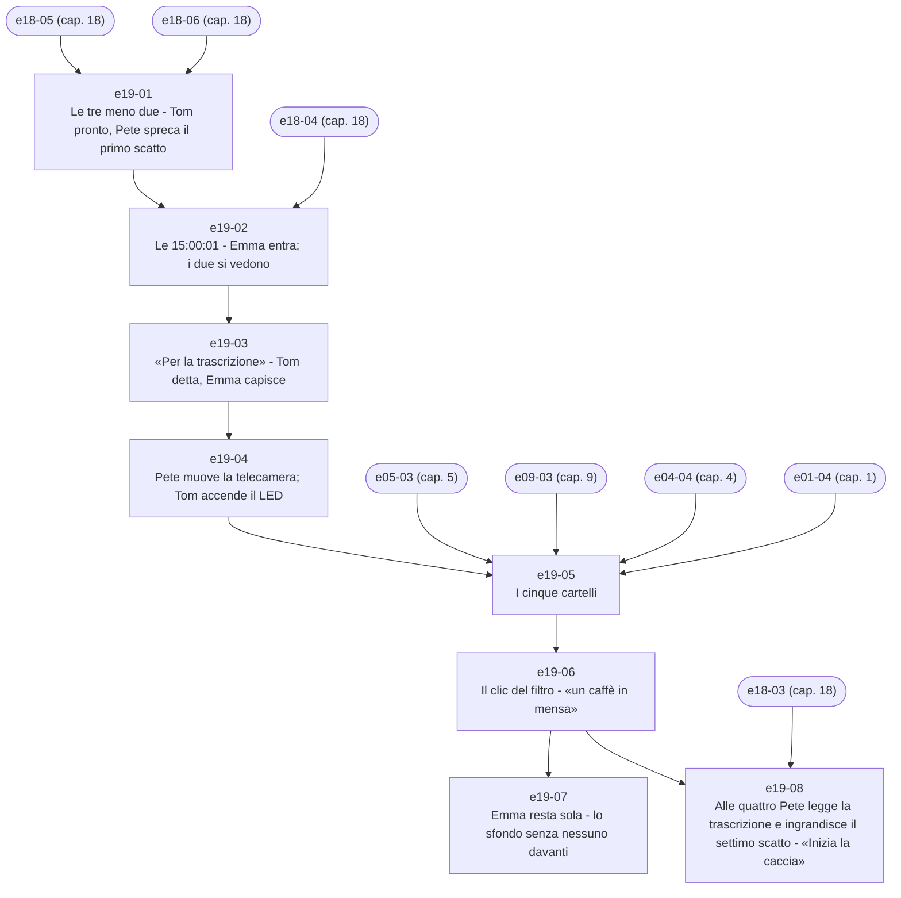

# Capitolo 19 — Il meeting

File: `chapters/19-il-meeting.md` · versione analizzata: 3.12

## Catena degli eventi

1. `e19-01` — [Le tre meno due - Tom pronto, Pete spreca il primo scatto](../eventi/e19-01.md) · sabato, 14:58-15:00
1. `e19-02` — [Le 15:00:01 - Emma entra; i due si vedono](../eventi/e19-02.md) · sabato, 15:00:01
1. `e19-03` — [«Per la trascrizione» - Tom detta, Emma capisce](../eventi/e19-03.md) · primi minuti del meeting
1. `e19-04` — [Pete muove la telecamera; Tom accende il LED](../eventi/e19-04.md) · durante il meeting
1. `e19-05` — [I cinque cartelli](../eventi/e19-05.md) · durante il meeting, a telecamera accecata
1. `e19-06` — [Il clic del filtro - «un caffè in mensa»](../eventi/e19-06.md) · fine del meeting, dopo nove minuti
1. `e19-07` — [Emma resta sola - lo sfondo senza nessuno davanti](../eventi/e19-07.md) · subito dopo il meeting
1. `e19-08` — [Alle quattro Pete legge la trascrizione e ingrandisce il settimo scatto - «Inizia la caccia»](../eventi/e19-08.md) · sabato, 16:00

## Schede toccate dal capitolo

- **Personaggi**: [Cliente del televisore del primo contatto](../personaggi/cliente-caso-zero.md), [Emma](../personaggi/emma.md), [Pete](../personaggi/pete.md), [La ragazza dei video eTv](../personaggi/ragazza-del-video-yoga.md), [Signora Voss](../personaggi/signora-voss.md), [Tom](../personaggi/tom.md)
- **Organizzazioni**: [Elab](../organizzazioni/elab.md), [Meridian](../organizzazioni/meridian.md)
- **Oggetti**: [L'appuntamento «Doppia» di Pete](../oggetti/appuntamento-doppia.md), [L'avatar e lo sfondo di Emma](../oggetti/avatar-di-emma.md), [I cinque cartelli di Tom](../oggetti/cartelli-di-tom.md), [Il LED del faretto da giardino (la contromossa di Tom)](../oggetti/led-del-faretto.md), [Log di sistema del secondo televisore](../oggetti/log-tv-secondo-contatto.md), [Nastro](../oggetti/nastro.md), [La newsletter di Benessere Meridian (modalità presenza)](../oggetti/newsletter-benessere.md), [I sette scatti di Pete](../oggetti/scatti-di-pete.md), [La telecamera di sorveglianza e il suo pannello](../oggetti/telecamera-di-sorveglianza.md), [La trascrizione del meeting](../oggetti/trascrizione-del-meeting.md), [Televisore del primo contatto (caso zero)](../oggetti/tv-caso-zero.md), [Televisore del secondo contatto](../oggetti/tv-secondo-contatto.md), [Il video girato dalla signora Voss](../oggetti/video-della-voss.md), [Il video di yoga («Yoga fit: diventa bella come me in 15 minuti al giorno»)](../oggetti/video-yoga.md)
- **Luoghi**: [Laboratorio di Tom](../luoghi/laboratorio-di-tom.md), [La mensa](../luoghi/mensa.md), [La postazione di Pete (open space dei supervisori)](../luoghi/postazione-di-pete.md), [La stanza di Emma (ex laboratorio Elab)](../luoghi/stanza-di-emma.md)
- **Concetti**: [Il bivio](../concetti/il-bivio.md), [Il meccanismo - la stessa cosa ripetuta finché non c'è più spazio](../concetti/meccanismo-della-ripetizione.md), [Trascrizione automatica obbligatoria](../concetti/trascrizione-automatica.md)
- **Termini**: [«compacting context»](../termini/compacting-context.md), [Modalità presenza](../termini/modalita-presenza.md), [Smutandata](../termini/smutandata.md), [Tabella di Conversione (di Pete)](../termini/tabella-di-conversione.md)
