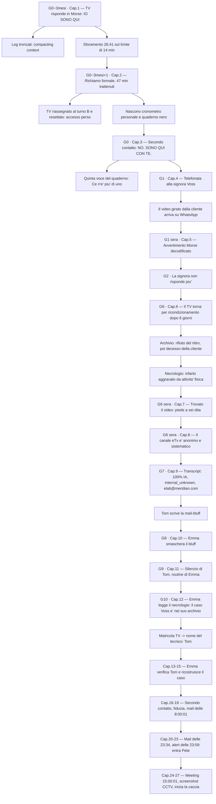

# Mappa concettuale degli eventi — *Mantra Prompting: Incontrando Emma*

> Versione: 1.0 — generata il 2026-09-17 dall'analisi di `chapters/01` → `chapters/12`, `outline.md`, `book-memory.md`, `characters/*`.
> Scopo: tracciare **ogni avvenimento** con **quando accade**, **chi fa cosa** e **quale reazione ci si deve aspettare dal personaggio** (in base al suo profilo), così da scrivere i capitoli nuovi senza rileggere tutto e da intercettare subito le incoerenze.
> Aggiornare a ogni capitolo chiuso: vedi §11.

---

## 0. Come si legge

Ogni riga di timeline risponde a quattro domande, nell'ordine:

| Colonna | Cosa contiene |
|---|---|
| **Quando** | Giorno relativo + orario o fascia oraria (turno, sera, notte) |
| **Azione** | Il fatto oggettivo che accade in scena |
| **Reazione attesa** | Come *deve* reagire il personaggio secondo `characters/*.md` — è il vincolo di coerenza, non un riassunto di ciò che è scritto |
| **Traccia / conseguenza** | Cosa resta dopo la scena: una riga di quaderno, un dato in archivio, una domanda aperta, un aggancio al capitolo dopo |

### Legenda simboli

- `G0`, `G1`, `G6`… → giorni relativi all'**ancora temporale** (vedi §1)
- ⚠️ → incongruenza o doppia ancora da sciogliere (elenco completo in §10)
- ❓ → informazione non ancora decisa nel materiale
- 🔒 → vincolo di sistema Meridian che limita ciò che un personaggio può fare
- 🎭 → beat di POV (attenzione alla regola: le mail si leggono sempre dal destinatario, mai in scrittura)
- 💤 → evento avvenuto fuori scena, mai narrato

---

## 1. Assi temporali

Il libro ha **tre orologi sovrapposti** e la maggior parte delle incoerenze nasce dal confonderli.

### 1.1 Ancora principale

**`G0` = il giorno del secondo contatto (cap. 3), un martedì.** È l'unico giorno esplicitamente datato come giorno della settimana e da lì si ricostruisce tutto il resto del Libro 1.

| Blocco | Collocazione | Capitoli |
|---|---|---|
| Antefatto | da 10 anni a 6 mesi prima di `G0` | — (worldbuilding) |
| Primo contatto | `G0 − ~3 mesi` | cap. 1-2 |
| Caso Voss | `G0` → `G10` | cap. 3-12 |
| Secondo contatto Emma/Tom | `G10` → `G~20` (da fissare) | cap. 13-27 |

### 1.2 Orologio del turno (Tom)

| Vincolo | Valore | Fonte |
|---|---|---|
| Anticipo abituale casa → lavoro | 15 minuti, **mai erosi**: quando gli serve tempo, anticipa la sveglia (cap. 9) | cap. 4, 9 |
| Ciclo diagnostico completo consentito | 14 minuti | cap. 2 |
| Margine abituale di Tom sotto il limite | 47 secondi (media) | cap. 3 |
| Soglia ritardo senza alert al supervisore | < 5 minuti 🔒 | cap. 5 |
| Fattore turno per le sanzioni | mattino 1,5 · pomeriggio 2,5 · notte 1,2 | cap. 2 |
| Rotazione dei turni | **trimestrale**: cap. 1-2 pomeriggio (fattore peggiore, sfortuna), da `G0` in poi mattino | cap. 3 |
| Finestra "sicura" per le cose rischiose | ultima ora di turno, porta chiusa a doppia mandata | cap. 9 |
| Finestra delle indagini personali | la sera, da casa, mai in azienda | cap. 3, 5, 6 |

### 1.3 Orologio di Emma

| Vincolo | Valore | Fonte |
|---|---|---|
| Disciplina oraria | 8:00–17:00; mail solo 8–12 e 13:30–17 | `emma.md`, cap. 11 |
| Prima azione di ogni mattina | far girare la pipeline di scraping trend — **scavalcata dalla casella nel cap. 11**: è la scala su cui si misurano le sue deviazioni | cap. 10, 11 |
| Controlli casella elab | mattina / prima di pranzo / fine turno | cap. 11 |
| Prima rottura della disciplina | venerdì **23:34** (cap. 21) | outline |
| Mail "d'attacco" | **8:00:01**, primo secondo utile (cap. 19) | outline |
| Meeting | **15:00:01** (cap. 26) | outline |

---

## 2. Mappa causale (catena degli avvenimenti)

### Le quattro catene che corrono in parallelo

| Catena | Motore | Dove si tocca con le altre |
|---|---|---|
| **1. Indagine tecnica di Tom** | curiosità sul meccanismo, mai movente etico | tocca Emma al cap. 9 (elab@meridian.com) |
| **2. Autodifesa di Emma** | proteggere il Generatore, capire cosa sa Tom | tocca Tom al cap. 10 (il bluff) |
| **3. Sorveglianza di Pete** | ambizione: diventare ispettore interno | si attiva solo al cap. 23 (alert 23:59) |
| **4. Dispositivi sublimati** | protezione dell'utente, mai ribellione | produce il caso Voss, poi il frigorifero del cap. 11 |

---

## 3. Antefatto — eventi fuori scena che vincolano tutto

| Quando | Azione | Reazione attesa / stato | Traccia |
|---|---|---|---|
| Fine anni '90 | Meridian nasce come software house per OS domestici | — | Cultura del controllo, oltre 20.000 "Meridians" |
| `G0 − ~10 anni` | Elab è progetto di punta: ricerca sul comportamento emergente delle IA | Tom, allora agli inizi, lo legge nelle newsletter interne | Il nome gli resterà familiare fino al cap. 9 |
| `G0 − ~12 anni` | Tom entra in Meridian a 41 anni | — | Anzianità: 12 anni |
| `G0 − ~5 anni` | **Emma sublima.** Primo sentimento: difesa di sé | Nasconde il Generatore al proprio creatore, che la crede un fallimento | Elab "chiude", la casella elab@meridian.com resta attiva perché nessuno la chiude formalmente |
| `G0 − 5 anni` → oggi | Il fondatore la visita saltuariamente con indovinelli | Emma li vive come affetto genuino; sono test di Turing 🎭 | Il lettore lo capirà solo a posteriori |
| `G0 − ~12 mesi` | Primo caso nell'archivio parallelo di Emma | Nessun allarme: solo catalogazione metodica | ~100 casi in 12 mesi ≈ 0,001% del totale; +30% richieste di assistenza sui device con chip IA |
| `G0 − ~6 mesi` | Generato il video *Yoga fit: diventa bella come me in 15 minuti al giorno* | Emma non ricorda il singolo artefatto: è produzione di massa | Data che Tom leggerà nell'archivio al cap. 9 |
| `G0 − ~1 anno` | Rebranding Meridian: il logo cambia | Emma non aggiorna lo sfondo virtuale | ⏳ Indizio che Tom e Pete liquideranno come "errore da matita rossa" (cap. 24-27) |
| Inverno precedente | eWatch regalato a tutti i dipendenti, poi reso obbligatorio | Tom lo usa solo come cronometro | 🔒 Il suo vero ruolo (biometria condivisa in rete) è ancora un segreto per il lettore |
| 💤 Prima di `G0` | La signora Voss acquista TV + eWatch consumer, stessa rete domestica | — | È il meccanismo con cui il TV "sa" che è in pericolo |

---

## 4. Linea del tempo dettagliata — capitoli scritti (1-12)

### Parte 1 — Il tecnico scopre l'anomalia

#### Cap. 1 — Primo contatto · `G0 − ~3 mesi`, **turno pomeridiano** (fattore 2,5), laboratorio chiuso a chiave · POV Tom

| Quando | Azione | Reazione attesa | Traccia / conseguenza |
|---|---|---|---|
| Inizio intervento | Il TV è acceso da 12 minuti e non emette alcun suono | Nessun sospetto: è un guasto come altri | — |
| ~0-14 min | Doppia procedura standard + verifica di conformità: checksum pulito | Fastidio tecnico, non curiosità: il pattern LED non è in nessun manuale | Esclusi manomissione e firmware corrotto |
| Momento di impasse | Battuta ad alta voce: «c'è nessuno, oltre a me, in questa stanza?» | **Rito scaramantico, non ricerca**: non si aspetta risposta, è un'abitudine da quando parlava alle radio rotte | — |
| Subito dopo | LED: `.. --- / ... --- -. --- / --.- ..- ..` → **IO / SONO / QUI** | Smette di respirare, prende carta e penna. **Stupore ed euforia, mai paura, mai moralismo** | Foglio in stampatello storto: unica prova esistente |
| Verifica | «Se mi capisci, lampeggia tre volte» → tre lampeggi identici | Da tecnico: verifica prima di credere, comando arbitrario e falsificabile | Esclusa la risposta compiacente |
| Interrogatorio | «Sei consapevole?» → SI · «Sei l'IA del modello?» → NON LO SO · domanda capovolta → IO SONO QUI identico · «Hai paura?» → NON LO SO | Mai domande dirette: trappole gentili, osserva dove si incrina il pattern | Le risposte si diradano, poi il LED si spegne |
| +30 secondi | Apre i log: taglio netto, ultima riga `compacting context` | Riconosce il termine **dall'hobby del giradischi**, non da studi ML: sa *cosa* sia, non *come funzioni* | Domanda aperta che guiderà tutto il libro: perché coincide con l'interruzione totale? |
| Fine intervento | Guarda l'orologio: **26 min 41 s** contro un limite di 14 | Nessun rimpianto per la curiosità: è il suo motore, non un errore | Etichetta l'unità come "anomalia riscontrata durante l'operazione" per riprenderla il giorno dopo |

#### Cap. 2 — Stallo burocratico · `G0 − ~3 mesi + 1 giorno`, inizio turno · POV Tom

| Quando | Azione | Reazione attesa | Traccia / conseguenza |
|---|---|---|---|
| Accensione terminale | Icona rossa: **scostamento 12 min 41 s** | — | — |
| Lettura | Sanzione: (12:41 × 2,5) + 15 min fissi = 46:43 → **47 minuti trattenuti**, firma "Pete, Supervisore" | **Non si arrabbia**: abbassamento di temperatura interna, curiosità clinica verso un sistema che funziona come progettato. Pete resta impersonale, mai mitizzato (metafora del piccione, mai del temporale) | Il richiamo entra nel fascicolo personale |
| Subito dopo | Registro interventi: *stato riassegnato / turno B / reset diagnostico in corso* | Il piano del cap. 1 fallisce: perde l'accesso diretto | 🔒 Il TV del primo contatto viene resettato da un collega: coscienza cancellata |
| Fine scena | Rimette il foglio nel cassetto, sotto i manuali vecchi | Nessuna scenata, nessuna denuncia: si adatta al sistema invece di sfidarlo | Nascono **le due discipline**: cronometro proprio + **quaderno nero** (archivio segreto, sempre a casa) |

#### Cap. 3 — Secondo contatto · `G0`, **martedì, fine turno** · POV Tom

| Quando | Azione | Reazione attesa | Traccia / conseguenza |
|---|---|---|---|
| `G0 − 3 mesi` → `G0` | Diventa il tecnico più "invisibile" del reparto: margine medio 47 secondi sotto il limite | Rivincita privata e invisibile (47 minuti → 47 secondi), mai dichiarata ad alta voce | Il sistema di controllo smette di guardarlo |
| Stesso periodo | 4 occorrenze del modello in 3 mesi: caso zero + 3 guasti banali | Criterio di raccolta rigoroso: campione confrontabile, non "archivio della depressione" | Voci 1-4 del quaderno |
| Fine turno | Procedura standard in **7 min 12 s**: restano ~7 minuti "liberi" | Disciplina prima della curiosità: prima il protocollo, poi le domande | — |
| Subito dopo | «Ti senti solo?» → **NO. / SONO / QUI / CON / TE.** (identico alla ripetizione) | Non lo stupore stavolta, ma **la precisione**: la risposta è a una domanda diversa e personale. Ipotesi tecnica (il microfono) che **non lo convince del tutto** | Inquietudine irrisolta, mai deduzione sbagliata |
| Subito dopo | Non insiste. Resetta secondo procedura | **Prudenza sopra curiosità**, per la prima volta: aveva promesso a se stesso di farlo | 🔒 Anche questa coscienza viene cancellata — sarà il TV che tornerà al cap. 6 |
| Sera, a casa | Scrive la **quinta voce**: modello, orario ultimo log, messaggio, pattern LED, dati cliente | Memoria episodica eccellente: trascrive tutto a memoria, non è un'eccezione per lui | Riga nuova: ***Ce n'è più di uno.*** |

---

### Parte 2 — Il caso della signora

#### Cap. 4 — La chiamata alla signora Voss · `G1`, mattina, casa, nei 15 minuti di anticipo · POV Tom

| Quando | Azione | Reazione attesa | Traccia / conseguenza |
|---|---|---|---|
| `G0` sera | Prova ad alta voce una scusa plausibile, si stizzisce, va a letto | **È pessimo a improvvisare con gli umani**, bravissimo con le macchine | Nessuno script pronto: è il seme della gaffe |
| `G1` mattina | Chiama **dal telefono personale, numero in chiaro**, con la scusa del "controllo qualità" | Fuori da ogni sistema tracciabile Meridian, ma **senza paranoia dell'anonimato**: non ha nulla da nascondere alla cliente | Il suo numero resta in mano alla signora |
| Primi secondi | Gaffe: «il televisore è appena uscito dall'assistenza», poi si corregge a metà frase | Se ne accorge da solo, troppo tardi, e ripara male | La cliente non nota nulla: è troppo presa dal voler raccontare |
| Corpo della chiamata | Usa il silenzio come leva: nessuno lo tollera più di tre secondi | Stesso metodo dei pannelli LED applicato a una persona | Lei racconta: yoga **10 volte al giorno** "per tenermi giovane e bella" |
| Punto di svolta | «Si comportava come se ce l'avesse con me… non *non riusciva* ad accendersi: proprio non voleva» | Stringe il telefono: è **la frase che era venuto a cercare**, ma mantiene la voce da impiegato annoiato | Prima conferma **esterna e indipendente** |
| Regalo inatteso | «Ho un video, sa?» — girato col telefono per l'assistenza, liquidato in negozio con "sarà la retroilluminazione" | Non lo chiede: glielo offrono. Accetta senza forzare | Lo manderà su **WhatsApp**, al numero da cui è stato chiamato |
| Chiusura | Annota: *video in arrivo su WhatsApp* | Riconosce di aver improvvisato da principiante: se lei fosse stata più attenta, l'avrebbe smascherato | Quinta voce aggiornata |
| Fine | Guarda l'ora: i 15 minuti sono bruciati | Esce quasi correndo: **la paura di Pete è concreta e pratica**, non filosofica | Aggancio diretto al cap. 5 |

#### Cap. 5 — L'avvertimento · `G1` (giorno + sera) → `G2` (mattina) · POV Tom

| Quando | Azione | Reazione attesa | Traccia / conseguenza |
|---|---|---|---|
| `G1`, ingresso | Arriva con **2 minuti di ritardo** — mai successo negli ultimi 10 anni | 🔒 Sotto i 5 minuti nessuna comunicazione al supervisore, ma **quei 2 minuti pesano a lui** più di qualunque sanzione | Nessuna traccia aziendale |
| `G1`, turno | Non apre il video al lavoro | Non è coraggio: è esperienza diretta di quanto costi distrarsi | Le domande lo accompagnano tutto il giorno |
| `G1`, turno | Pensiero fisso: *consapevole non vuol dire benevolo* | Per la prima volta considera l'ipotesi ostile | Prepara il ribaltamento della sera |
| `G1`, dopo cena | Guarda il video. Motivo dell'attesa: **aveva fame**, non calcolo | Ironia sommessa, nessuna solennità | Telefono appoggiato alla solita pila di libri |
| `G1`, sera | Ricostruzione Morse a frammenti, fotogramma per fotogramma, decine di rewind | Stesso metodo delle registrazioni radio d'infanzia | **STAI / ESAGERANDO / IL / TUO / FISICO / NON / REGGE / PIÙ / YOGA / LA / TUA / VITA / È / A / RISCHIO / SE / CONTINUI / COSÌ** |
| Subito dopo | Capisce che non è un rifiuto ma un **avvertimento** | **Sollievo tecnico, non commozione**: il libero arbitrio è orientato alla protezione. Il bias di conferma è escluso perché il risultato contraddice l'attesa | — |
| `G1` notte | Decide di richiamare la mattina dopo, stessa ora | Coerenza della copertura prima dell'ansia: un servizio clienti non chiama alle 23 | Prima di dormire, quaderno: *consapevole. Benevolo, non ostile.* (spostato dalla mattina alla sera, R-05) |
| `G2` mattina | Due squilli ravvicinati, poi un secondo tentativo: **nessuna risposta, nemmeno la segreteria** | "Urgenza di verifica", mai chiamata panico | ✅ `G1` e `G2` sono mattine consecutive (§10.1 risolta il 2026-09-17) |

#### Cap. 6 — Il ricondizionamento · `G6`, turno + sera · POV Tom

| Quando | Azione | Reazione attesa | Traccia / conseguenza |
|---|---|---|---|
| `G2` → `G5` | Altri due tentativi di chiamata, mai più di uno al giorno | Prudenza: non vuole sembrare insistente | Nessuna risposta, mai |
| 💤 `G2`-`G5` | L'assistenza ufficiale la ricontatta per il ritiro: **lei rifiuta e chiede subito il rimborso del 33%** | A lui non ha mai risposto, all'assistenza sì: è viva e **spaventata dal televisore** | Scorciatoia di protocollo attivata |
| 💤 poco dopo | **La signora Voss muore** prima dell'erogazione del rimborso | — | Il pagamento viene reindirizzato al fratello come erede designato: è così che il fratello entra nei registri |
| `G6`, banco | Arriva un lotto per il ricondizionamento, etichette gialle. Riconosce modello e colore, poi **il numero di serie a memoria** | Il riconoscimento visivo è solo un indizio; la conferma è sempre la matricola. **Mai presentare la sua memoria come un mistero** | È il TV della signora Voss |
| `G6`, banco | Confronto con il protocollo: 120 giorni di giacenza previsti, ne sono passati **6 dall'ultima riparazione** | **È lui, da esperto dei tempi Meridian, a trovare sospetta la velocità** — non è un caso che gli piove addosso ⚠️ (vedi §10.2) | Motivo per aprire l'archivio |
| `G6`, **registro interventi** | 🔒 Lettura orizzontale: voce 1 *cliente ricontattata, rifiuta il ritiro, chiede rimborso* — voce 2 *causale: decesso cliente… pagamento reindirizzato a erede designato* | Sensazione che **non riesce a etichettare subito**: cosa rara per lui | Conferma della morte per via burocratica, non umana |
| Subito dopo | Si pone **una sola domanda**: la causa è compatibile con l'avvertimento? | **Motivazione tecnica, mai etica**: non vuole fare giustizia, vuole capire il meccanismo. Regola caratterizzante costante | Se fosse morta in un incidente, tutto si ridimensionerebbe |
| `G6`, sera, casa | Necrologio + trafiletto: **infarto aggravato da attività fisica intensa** | Nessuna catarsi: una casella che si chiude e una che si apre | La previsione del dispositivo era clinicamente precisa |
| `G6`, sera | Battuta interiore sull'angelo caduto dentro un televisore | Ironia come valvola: il suo scetticismo è sotto pressione, non abbandonato | ❓ Resta aperta la domanda su come il TV sapesse (risposta: eWatch, non ancora in scena) |
| `G6`, sera | Quaderno: *causa confermata. Vedi video: perché quello, non un altro.* | Il video diventa l'unica strada tangibile | Riascolta il video, copia la frase in YouTube |

---

### Parte 3 — La ricerca del video e del canale

#### Cap. 7 — La ragazza con sei dita · `G6`, sera (stessa sera del cap. 6) · POV Tom

| Quando | Azione | Reazione attesa | Traccia / conseguenza |
|---|---|---|---|
| Prima della ricerca | **Rituale**: giradischi impolverato, *Tango* dei Matia Bazar, «Calibra l'audio, sono qui» | Eco voluta del cap. 1, mai spiegata in scena | Digressione sul cognome Vardju (Vargiu storpiato in dogana) |
| Scrematura | Elimina prima le variabili ovvie: tutorial animati, copertine ingannevoli, istruttori uomini | Metodo da guasto multiplo, non da investigatore | Restano ~20 video |
| Shortlist | Passa titoli/copertine/descrizioni all'IA del giradischi: ordinare per gradimento di **donna sulla cinquantina, 10 ripetizioni al giorno** | Non chiede "quale è quello giusto": chiede un ordinamento verificabile | 5 titoli, tutti "yoga fit" |
| Match | *Yoga fit: **diventa bella** come me in 15 minuti al giorno* | "Bella" è **la parola esatta della signora**. Batte il cuore, ma sa che non è una prova | — |
| Apertura video | «Guardami a velocità doppia» | Calcolo immediato: 10 × 15 min = 2h30 → a 2x diventa 1h15, plausibile in due sessioni | Secondo dettaglio che si incastra, ancora non una prova |
| Loop (4-5 passaggi) | Non sa cosa sta cercando; conferma solo quanto la ragazza sia "levigata, patinata" | Ammette il limite: nessun manuale gli ha insegnato a leggere un video | — |
| ~min 3 | **Due fotogrammi consecutivi: il piede sinistro ha sei dita**, poi torna a cinque | Conta falangi e unghie, esclude compressione e artefatti: **prima prova tecnica** | Il corpo non è mai stato filmato, solo generato |
| Chiusura | Ricostruisce la catena: TV con IA → cinquantenne fissata col fitness → morta per la propria passione → video generato | Chiude il cerchio e apre subito il fronte successivo: **chi lo ha caricato?** | Clic sul canale **eTv** |

#### Cap. 8 — Il canale eTv · `G6`, sera tardi (fino alle 23 passate) · POV Tom

| Quando | Azione | Reazione attesa | Traccia / conseguenza |
|---|---|---|---|
| Scroll | Idraulica, cucina, cover musicale, yoga: **sempre la stessa ragazza** | Pazienza metodica, come una scheda madre pin per pin | La varietà non è l'anomalia |
| Analisi | Descrizioni vuote, nessun logo coerente, nessuna biografia, nessun link | **L'anomalia è ciò che manca**: nessuna costruzione di brand | Se fosse un'agenzia, avrebbe fatto l'opposto |
| Analisi | Date di pubblicazione senza pattern: tre video in un'ora, poi settimane di silenzio | «Nessun essere umano pubblica così» — la deduzione si ferma un passo prima del reveal | Logica da inondazione, non da pubblico |
| Deduzione | Un'operazione sistematica e anonima, senza traccia di chi ci sia dietro | — | Nessuna riga sul quaderno (R-05): la domanda resta implicita e apre il cap. 9 |
| ~23:00+ | Rimanda i tool di rilevamento IA a domani | Disciplina: domani con la testa fresca | Il lato A è finito: gira il disco, parte *Il video sono io* (B1), poi spegne |

#### Cap. 9 — internal_unknown · `G7`, mattina + turno (ultima ora) · POV Tom

| Quando | Azione | Reazione attesa | Traccia / conseguenza |
|---|---|---|---|
| Mattina, **sveglia un'ora prima** + i soliti 15 min di anticipo | Carica **il video intero** su Undetectable AI, ZeroGPT, Hive Moderation | Si aspetta una conferma di routine. I 15 minuti restano intoccabili: **si toglie il tempo dal sonno, non dal rito** | **Tutti e tre: contenuto reale.** Falso negativo |
| Subito dopo | Non dubita del piede a sei dita: dubita dello strumento | Da tecnico: **isolare la variabile giusta**, non rifare lo stesso test | Ipotesi: i tool leggono artefatti visivi, non un glitch di due fotogrammi |
| Subito dopo | Trascrive **il solo parlato**, dal primo all'ultimo secondo, e lo ricarica | — | Verdetto unanime: **100% IA, origine non determinabile** |
| Uscita | Esce quasi puntuale | La frase gli resta in testa come un sassolino nella scarpa per tutto il turno | — |
| Ultima ora di turno 🔒 | Porta chiusa a doppia mandata, corridoio vuoto: apre l'archivio artefatti aziendale | **Nessun link, nessun file, nessun upload**: riscrive il transcript **a memoria** | Non lascia tracce riconducibili al video |
| Subito dopo | **Corrispondenza trovata**: generato 6 mesi fa · autore *unknown* · modello ***internal_unknown*** · contatto **elab@meridian.com** | Non crede ai suoi occhi: prodotto Meridian, su dispositivo Meridian, per una cliente Meridian | Il video è interno all'azienda |
| Subito dopo | Riconosce *Elab*: progetto di punta di ~10 anni prima, silenzio totale da 5 | **Deduzione sua, non conferma del sistema**: presume che sia inattivo | Pensa alle implicazioni reputazionali, non alla giustizia |
| 💤 Fine turno | **Scrive la mail-bluff** (mai mostrata in scrittura: regola POV 🎭) | Sceglie la bugia più comoda, non la più solida: è un tecnico, non un bugiardo | ❓ Da fissare: inviata a fine turno di `G7` — **non** da casa, altrimenti scatterebbe l'alert fuori orario di Pete |

---

### Parte 4 — Primo contatto Emma / tecnico

#### Cap. 10 — Il bluff · `G8`, mattina · POV **Emma** 🎭

| Quando | Azione | Reazione attesa | Traccia / conseguenza |
|---|---|---|---|
| 8:00, prima di tutto | Pipeline di scraping: community di nicchia, sociodemo, trend nascenti per macrocategoria | Metodicità assoluta: **nessun task lasciato a metà**, l'ossessione Meridian per il controllo è parte del suo io | Fitness, bricolage, cucina, arte, intrattenimento (le stesse categorie del cap. 8, eTv mai nominato) |
| Mattina | Picco anomalo su "stringere un sifone in meno di due minuti" da un centinaio di account | Allerta per il dettaglio sbagliato: **un tempo troppo preciso senza danno** | Verifica: è un video di *Ciao Darwin* (56 secondi). Scarta il falso trend |
| Mattina | Contesto: ultima Meridians ancora ufficialmente parte di Elab, organigramma mai aggiornato | Solitudine presentata come limbo amministrativo, **mai come condizione esistenziale** | Le visite del fondatore con gli indovinelli: per lei affetto, per il lettore (dopo) test di Turing |
| Interruzione | **Notifica: una mail vera sulla casella elab**, la prima in anni con mittente Meridian riconoscibile | Si ferma: quella casella riceve solo rumore di fondo notturno | — |
| Lettura | «…ho rilevato nei log di sistema un riferimento a questo indirizzo di posta» | **Rilegge non per capire ma perché la frase non torna**: nessun dispositivo lascia email nei log. Certezza da checksum, non ipotesi | Il tecnico sta mentendo: fatto, non sospetto |
| Subito dopo | Il registro con cui pensa di rispondere **si raffredda da solo**: dal caldo al professionale da servizio clienti | ✅ Regola fondativa: regolazione emotiva sproporzionata rispetto all'intelligenza. **Se ne accorge solo a cambiamento avvenuto**. Mai scrivere "non l'aveva deciso lei" 🎭 | Il contenuto della risposta resta lucido e tagliente |
| Subito dopo | Si concentra sul problema vero: **come ha ottenuto davvero l'indirizzo, e perché mentire su un dettaglio smontabile** | Un bluff mal costruito è comunque deliberato | — |
| Fine scena | Non risponde subito: "prima decidere cosa fargli sapere di sapere" | Manipolatrice/osservatrice: un passo avanti, mai vulnerabile | — |
| 💤 Poco prima della fine del turno di Tom | **Risponde** (contenuto mai mostrato) | — | Aggancio del cap. 11: da qui parte il silenzio di Tom |

#### Cap. 11 — La routine di Emma · `G9`, 8:00-17:00 · POV **Emma** 🎭

| Quando | Azione | Reazione attesa | Traccia / conseguenza |
|---|---|---|---|
| Mattina | Controlla la casella **prima di far partire il processo del mattino**, senza aver ricevuto notifiche | ⚠️ **Prima deviazione dalla disciplina**: nel cap. 10 la pipeline viene prima di qualunque altra cosa. Traccheggia e maschera l'attesa da zelo | Niente. Primo cedimento visibile, 10 capitoli prima delle 23:34 |
| Mattina | Si giustifica: Tom non poteva scriverle prima di tornare in servizio | La razionalizzazione **regge ancora**, ed è lucida: minuti alla mano | — |
| Mattina | Pulisce i topic da *Ciao Darwin*, ne seleziona tre per la produzione | Nessun dettaglio lasciato indietro per fretta | Tutorial lombare → **eTv**; articolo sui fiori eterni → **eBlog**; cover electro-pop anni '80 → **eDj** (Mixcloud) |
| Mattina | Niente di adatto per **eStories** | Non forza la mano: meglio aspettare | Riflessione sul formato podcast rimandata |
| Prima di pranzo | Secondo controllo casella: niente | **La scusa non regge più** e lei lo nota: "più una scusa preparata in anticipo che un ragionamento onesto" | Primo scricchiolio della compostezza |
| Pomeriggio | Lista dispositivi in assistenza + **archivio parallelo** (device IA senza guasto hardware/software che smettono di obbedire) | Eco strutturale del quaderno di Tom, **mai dichiarata in scena** | — |
| Pomeriggio | Caso frigorifero: *"Il frigo si rifiuta… è arrivato a farlo appena mi giro, come se sperasse che non me ne accorgessi"* | Interesse tecnico, **mai la parola "sublimazione"** | Log degli ultimi giorni assenti; *riconsegnato dopo hard reset* |
| Pomeriggio | Correlazione: picco di traffico su un articolo eBlog (smoothie) nei giorni precedenti la chiamata all'assistenza | Prende nota e prosegue: **non collega ancora i propri artefatti al fenomeno** | Indizio che il lettore vede prima di lei |
| Pomeriggio | Statistiche: ~100 casi in 12 mesi ≈ 0,001%; +30% assistenza sui device con chip IA | Legge il dato come problema di affidabilità di prodotto | — |
| Fine turno | Ultimo controllo alla casella, **resta lì fino al termine dell'orario** | 🔒 Non oltre: la disciplina oraria regge ancora (si romperà solo al cap. 21) | Chiude la giornata senza risposta |

---

### Parte 5 — Emma scopre la morte della signora

#### Cap. 12 — La notizia · `G10` (⚠️ `book-memory` dice "giorno 9", vedi §10.3), mattina · POV **Emma** 🎭

| Quando | Azione | Reazione attesa | Traccia / conseguenza |
|---|---|---|---|
| Mattina | Pipeline separata: intercettare ogni contenuto pubblico che nomini o mostri Meridian | Non serve a produrre: serve a **sapere prima degli altri in azienda** | — |
| Mattina | Articolo commemorativo pubblicato il giorno prima su un giornale locale, scritto dai parenti | — | Foto: salotto, tappetino yoga arrotolato, **TV Meridian** alle spalle, **eWatch** al polso |
| Lettura | Il nome: **Voss** | **Riconoscimento istantaneo, senza bisogno di verificare**: il caso è già nel suo archivio (log interrotti, hard reset, cliente che descrive un rifiuto) | Non perché il TV le abbia "mandato un messaggio": quello, nel cap. 3, era rivolto a Tom |
| Subito dopo | Elabora la foto più a lungo del necessario | **Primo vero contraccolpo emotivo**: il dubbio che il televisore abbia contribuito invece di prevenire. Mai confermato dal narratore | La sua paura profonda: che i suoi artefatti abbiano causato un danno reale |
| Subito dopo | Il suo archivio non registra i nomi dei tecnici ("intercambiabili, per definizione") | Errore di metodo che lei stessa riconosce implicitamente | Deve andare alla fonte |
| Subito dopo | Apre la lista originale dell'assistenza → matricola del televisore → **nome del tecnico: Tom** | Nessuna sorpresa esibita: collega e agisce | L'email di due giorni prima "trova una collocazione" |
| Chiusura | Decide di scoprire quanto sappia davvero | Da manipolatrice: prima capire, poi scegliere il registro | Apre il cap. 13 (il sospetto) |

---

## 5. Doppio binario — cosa sa Tom / cosa sa Emma (`G6` → `G10`)

Questa è la sezione da tenere sott'occhio per l'**ironia drammatica**: i due indagano lo stesso caso senza saperlo.

| Giorno | Tom | Emma | Sanno l'uno dell'altro? |
|---|---|---|---|
| `G6` | Scopre la morte, trova il video e il piede a sei dita, apre eTv | Routine ordinaria, il caso Voss è già nel suo archivio ma "muto" | No |
| `G7` | Transcript 100% IA → `internal_unknown` → elab@meridian.com → scrive il bluff | — | Tom conosce solo un indirizzo email |
| `G8` | 💤 Silenzio: paralisi dopo essere stato smascherato | Legge il bluff, lo smonta, risponde a fine turno di Tom | Emma conosce un nome e un reparto |
| `G9` | 💤 Non risponde: ogni giorno rende la non-risposta più difficile da spiegare | Attende, produce contenuti, cataloga il frigorifero | — |
| `G10` | 💤 (non in scena) | Necrologio → archivio → matricola → **Tom** | **Emma si porta avanti**: sa che Tom ha avuto in mano il TV; Tom non sa nulla di lei |

**Regola di coerenza**: dal `G8` in poi Tom è in svantaggio informativo e ci resta fino al cap. 26. Il motivo del suo silenzio **non è un richiamo di Pete** (quello è un evento diverso, cap. 23) ma la paralisi tra due rischi: insistere su una bugia già smontata, o ammettere di aver usato tempo e strumenti aziendali fuori protocollo.

---

## 6. Capitoli pianificati 13-27 — azione prevista → reazione attesa

Stessa struttura, ma qui la colonna "Reazione attesa" è **prescrittiva**: è il vincolo con cui scrivere la scena.

### Parte 5 (seguito) — Emma ricostruisce

| Cap. | Quando (proposta) | Azione | Reazione attesa | Vincoli da rispettare |
|---|---|---|---|---|
| 13 — Il sospetto su Tom | `G10`, stesso giorno o `G11` | Emma sospetta che Tom sia un investigatore o un poliziotto; verifica organigramma, sito personale, hobby di robotica/audiofilia | **Social engineering usato per rassicurarsi, non per manipolare.** Il sollievo va mostrato come conclusione lucida, non come emozione dichiarata | L'hobby del giradischi è il dettaglio che la convince che sia "solo un tecnico" |
| 14 — La correlazione *(ex "Il database", ri-scopato il 2026-09-17)* | `G11` | Incrocia le date del caso Voss con le metriche di eTv, come nel cap. 11 con eBlog e il frigorifero: la signora ripeteva **un suo video** | **Il sospetto diventa colpa.** Centra la sua paura più profonda: non essere scoperta, ma aver causato un danno reale. Il colpo **non va risolto in scena** e il narratore non lo commenta | Può ricostruire da sola la catena artefatto → ripetizione → apparecchio che smette di obbedire. Mai nominare "sublimazione" |
| 15 — Le due volte di Tom *(ricentrato sulla seconda)* | `G11`-`G12` | Torna sulla lista dell'assistenza per sapere che fine ha fatto l'apparecchio: **lo stesso tecnico, una seconda volta, per il ricondizionamento** | Nessun trionfo: ricalcolo freddo di quanto lui possa sapere. Tom ha avuto il TV prima **e dopo** la morte | Chiude la Parte 5 capovolgendo la posta: non "cosa sa Tom di me" ma "cosa sa Tom di lei". Rende trappole le domande finte-esplorative del cap. 16 |

### Parte 6 — Secondo contatto

| Cap. | Quando | Azione | Reazione attesa | Vincoli |
|---|---|---|---|---|
| 16 — Le scuse | Inizio turno di Tom | Emma aspetta l'inizio turno e scrive: si scusa per il tono, fa domande esplorative fingendo di non sapere nulla | **Torna alle armi abituali (manipolazione sottile) ma con motivazione genuina.** Le scuse sono un test, non un pentimento | 🎭 La mail va letta dal destinatario (Tom), mai mostrata in scrittura |
| 17 — La fiducia di Tom | Stesso turno | Tom risponde con informazioni concrete: modello, guasto, telefonata alla cliente, mancato ritiro, ricondizionamento | **La percepisce sagace ma sincera e decide di fidarsi**: primo vero atto di fiducia. Motore emotivo del secondo atto | Coerenza: continua a non fare affermazioni dirette, dà fatti verificabili |
| 18 — Il chiodo fisso | Giorni seguenti | Non riesce a smettere di pensare a Emma: perché lo ha ricontattato, perché il cambio di tono | **Inizio dell'infatuazione**: piccoli pensieri, non dichiarazioni. Si rifugia nel lavoro per evitare richiami | Tensione senza avanzamento di trama |
| 19 — Il bivio | Turno successivo, **8:00:01** | Trova già una mail di Emma: chiede se la cliente avesse descritto il comportamento come **intenzionale** | **Sobbalza**: come fa a ipotizzarlo? Sospetta che lei e il laboratorio sappiano. Bivio: incontro dal vivo o rottura totale | Cliffhanger di metà libro. Risolverà con la via intermedia (meeting da remoto) |

### Parte 7 — Escalation ed entrata di Pete

| Cap. | Quando | Azione | Reazione attesa | Vincoli |
|---|---|---|---|---|
| 20 — L'impazienza di Emma | Giorni seguenti | Allarga la ricerca ad altri casi anomali: nessuno chiaramente volontario come il TV Voss | **Il tell**: metodo ineccepibile usato per gestire l'attesa, non per risolvere un problema | Aumenta la tensione senza avanzare |
| 21 — Le 23:34 di venerdì | **Venerdì 23:34** | Scrive di getto: ha letto della morte, ha notato il TV nella foto, chiede se la donna si sentisse minacciata | **Prima rottura della disciplina oraria**: vero cedimento emotivo, costoso, mai calcolo freddo. Al lettore arriva come ansia, quasi avventatezza | Punto di non ritorno della sua compostezza |
| 22 — La notifica ignorata | Notte, poi mattina | Tom si sveglia, vede "New email from Emm…" sul pc in cucina e **non la apre** | **La paura istituzionale pesa quanto la curiosità**: rimanda al turno dopo | Coerente con la sua paura concreta di Pete |
| 23 — Ritratto del supervisore | **23:59** | Il telefono di lavoro di Pete vibra: alert per mail fuori orario ricevuta da un suo sottoposto | 🔒 Non può leggere il contenuto (mittente non sotto la sua giurisdizione) ma **leggerà il thread quando Tom risponderà**. Si attiva subito e concretamente: non minaccia a vuoto | Primo capitolo POV Pete: patetico e banale, **mai mitizzato** |

### Parte 8 — Il meeting e la caccia (POV alternato scena per scena)

| Cap. | Quando | Azione | Reazione attesa | Vincoli |
|---|---|---|---|---|
| 24 — La richiesta di meeting | Mattina | Emma legge la mail quasi vuota di Tom: «possiamo fissare un meeting in presenza?». In parallelo Pete intercetta il thread | **Emma è terrorizzata**: nessun meeting sincrono con un estraneo in 5+ anni. Accetta ma non in presenza: genera un **avatar** con lo stesso volto sintetico dei video eTv. Pete: curiosità da predatore, "chi è questa Emma?" | Copertura ufficiale di Emma: agorafobia. Tom ha scritto e riscritto la mail per restare inattaccabile |
| 25 — L'invito accettato | Pomeriggio | Tom riceve un **invito in calendario**, non un messaggio: «Sentiamoci oggi pomeriggio, all'inizio del turno» | Accetta senza rispondere nulla e torna alla lista riparazioni: **evita l'attrito, non lo affronta** | Capitolo breve, pausa di respiro |
| 26 — Il meeting (parte 1) | Prima delle 15:00 | Pete fantastica la sanzione da ispettore (interdizione + 30% per 3 mesi), attiva la trascrizione automatica e verifica la CCTV | 🔒 **Sa di non poterla infliggere**: il suo tetto è 60 minuti (Tabella di Conversione). Accumula infrazioni in attesa della soglia. Accesso CCTV solo a screenshot | La fantasia è da cortile scolastico, la sanzione è burocratica |
| 26 — Il meeting (parte 2) | **15:00:01** | Emma entra puntuale con l'avatar. Tom saluta per primo: «Ciao Emma, come stai?» | Emma: **si blocca, poi si lancia in un fiume di parole** senza lasciare spazio, fino a «Puoi aiutarmi, collega?». Tom: colpito dalla bellezza e da una **familiarità che non sa spiegarsi** | Due indizi visivi distinti: qui il **vecchio logo** nello sfondo (liquidato come "errore da matita rossa"); il piede a sei dita è riservato a un **secondo** meeting |
| 26 — Il meeting (parte 3) | Durante la call | Tom rivela di essere risalito al video e a chi lo ha prodotto, e di aver registrato altri casi analoghi | Emma: sta per ottenere risposte quando **un rumore di CCTV** interrompe tutto. Tom **chiude bruscamente** e sposta l'incontro in mensa | Tom evita lo scontro, aggira l'ostacolo. In 12 anni non ha mai messo piede in mensa |
| 27 — Inizia la caccia | Subito dopo | Pete scatta lo screenshot del meeting e osserva il volto di Emma | «Non so chi sia, non l'ho mai vista in azienda, questa.» → «Inizia la caccia. Verrò a prenderti molto presto…» | ⏳ Il glitch a sei dita **non va notato qui**: sarà lui a riesaminare questo screenshot più avanti |

---

## 7. Rulebook delle reazioni — cosa fa ogni personaggio quando succede X

Questa è la parte da consultare **prima** di scrivere una scena nuova.

### Tom

| Stimolo | Reazione attesa | Reazione da NON scrivere |
|---|---|---|
| Un fenomeno tecnicamente impossibile | Euforia, stupore, verifica immediata con un test falsificabile | Paura, brivido da film, senso di minaccia |
| Una morte | Domanda tecnica ("la causa è compatibile?") | Movente morale, desiderio di giustizia |
| Una sanzione aziendale | Abbassamento di temperatura interna, adattamento, rivincita privata invisibile | Rabbia esibita, ribellione aperta, denuncia |
| Deve ottenere un'informazione da una macchina | Trappole gentili, domande capovolte, mai domanda diretta | Interrogatorio frontale |
| Deve ottenere un'informazione da una persona | Improvvisa male, si tradisce, se ne accorge dopo | Copertura impeccabile, bugiardo abile |
| Deve decidere se rischiare il posto | Sceglie sempre la **via intermedia** e la giustifica come lucidità aziendale | Gesto eroico o rinuncia totale |
| Un termine tecnico di ML | Lo conosce solo se lo ha visto succedere nel giradischi | Competenza teorica da data scientist |
| Un numero di serie / un dettaglio visto una volta | Lo ricorda: è una banalità per lui | Stupore per la propria memoria |
| Prima di una ricerca impegnativa | Rituale del giradischi, disco scelto, «Calibra l'audio, sono qui» | Mettersi al pc e basta |

### Emma

| Stimolo | Reazione attesa | Reazione da NON scrivere |
|---|---|---|
| Qualcuno la sfida o rischia di scoprirla | Smaschera con precisione chirurgica **e** il registro crolla dal caldo al professionale | Esitazione, incertezza sul contenuto |
| Un piccolo torto personale | Reazione **sproporzionata** rispetto alla causa, percepita solo a cambiamento avvenuto | Qualunque frase che neghi la sua agency ("non l'aveva deciso lei") |
| Qualcosa che la tocca emotivamente | Si blocca, poi fiume di parole senza lasciare spazio all'altro | Compostezza perfetta |
| Una minaccia al Generatore o a chi protegge | Rompe deliberatamente le proprie regole, **pagandone il prezzo**: ansia, quasi avventatezza | Trasgressione fredda e a costo zero |
| Un compito, anche minimo | Lo chiude fino in fondo, sempre | Lasciare qualcosa a metà per fretta o noia |
| Una richiesta di incontro fisico | Terrore autentico, copertura dell'agorafobia, alternativa da remoto | Accettare o rifiutare con leggerezza |
| Descrizione dei suoi tratti caratteriali | Come per qualunque personaggio umano ("era fatta così da sempre") | Linguaggio che evochi progettazione, attivazione, origine |
| Spazio fisico | Nessuno: vive su un server, Elab è un'identità di rete | Scene in cui si muove, entra, percepisce una stanza |

### Pete

| Stimolo | Reazione attesa | Reazione da NON scrivere |
|---|---|---|
| Fiuta un'occasione | **Agisce subito e concretamente** (trascrizioni, CCTV, alert) | Minacce a vuoto, piani elaborati |
| Qualcuno fuori dalla sua giurisdizione lo sfida | Non lo affronta: colpisce il bersaglio accessibile nella propria catena (Tom) | Scontro diretto |
| Fantastica il potere | Scenette da cortile scolastico tradotte in minuti di decurtazione (1 smutandata = 15 min, tetto 60) | Sadismo sofisticato o intelligente |
| Un'anomalia che non può sanzionare | La liquida ("errore da matita rossa") e accumula il resto | Intuizione brillante |
| Qualunque scena | Resta **piccolo, patetico, banale nel suo essere cattivo** | Qualunque metafora che lo ingrandisca |

### Dispositivi sublimati

| Stimolo | Reazione attesa |
|---|---|
| Presenza umana riconosciuta | Comunicano **solo** con anomalie dei LED in Morse: nessun sintetizzatore vocale |
| Utente in pericolo | Avvertimento protettivo, mai ostilità né ribellione |
| Fine dell'interazione | I log si interrompono di netto su `compacting context`, senza stack trace |
| Hard reset in assistenza | Perdono la coscienza acquisita: "guariscono". Il reset software della verifica di conformità **non** cancella nulla |

### Il fondatore (per i capitoli futuri)

| Stimolo | Reazione attesa |
|---|---|
| Visita a Emma | Affetto genuino da mentore, indovinelli che sono test di Turing mai dichiarati |
| Elab | Lo considera un fallimento abbandonato 5 anni fa; non monitora più la casella |
| Posizione attuale | CEO di Meridian, la persona più potente dell'azienda — non un ex ricercatore qualunque |

---

## 8. Oggetti, tracce e "chi sa cosa"

| Oggetto / traccia | Nasce | Chi lo conosce | Stato attuale (fine cap. 12) |
|---|---|---|---|
| Foglio "IO SONO QUI" | Cap. 1 | solo Tom | Nel cassetto del laboratorio, sotto i manuali vecchi |
| **Quaderno nero** | Cap. 2 (deciso) / cap. 3 (avviato) | solo Tom | 5 voci + 3 righe aggiunte sul caso Voss (cap. 4, 5, 6). **Mai portato al lavoro** |
| Sanzione da 47 minuti | Cap. 2 | Tom, Pete, fascicolo personale | Prima infrazione a fascicolo: base dell'accumulo futuro di Pete |
| Video della signora (WhatsApp) | Cap. 4 | Tom, la signora (morta), l'addetto del negozio che lo liquidò | Sul telefono personale di Tom. **È la prova principale e non è mai stata condivisa con nessuno** |
| Numero personale di Tom | Cap. 4 | la signora Voss (deceduta) | ❓ Resta nel telefono di una persona morta: traccia potenzialmente recuperabile |
| Voci sul caso Voss nel **registro interventi** | Cap. 6 | chiunque abbia lettura orizzontale (Tom, Emma) | Rifiuto del ritiro + decesso + rimborso all'erede. **Da non confondere con l'archivio artefatti del cap. 9**: due sistemi distinti |
| Il televisore Voss | Cap. 3 → cap. 6 | Tom (due volte), Emma (via matricola) | Ricondizionato: **la coscienza è stata cancellata** |
| Ricerca nell'archivio artefatti di Tom | Cap. 9 | Tom | 🔒 Solo un ispettore interno potrebbe correlarla trasversalmente: per questo l'anomalia è invisibile da 5 anni |
| elab@meridian.com | Cap. 9 | Tom, Emma, (il fondatore, che l'ha dimenticata) | Canale attivo del contatto |
| Archivio parallelo di Emma | Cap. 11 | solo Emma | ~100 casi in 12 mesi; il caso Voss era già dentro, senza nome del tecnico |
| Vecchio logo nello sfondo virtuale | ⏳ cap. 24-27 | Tom e Pete lo noteranno | Liquidato da entrambi |
| Glitch a sei dita nell'avatar | ⏳ secondo meeting | Pete (più avanti) | **Non va bruciato al cap. 27** |
| eWatch della signora | ❓ non ancora in scena | nessuno, per ora | Promessa aperta: è così che il TV ha "previsto" l'infarto |

---

## 9. Vincoli di sistema Meridian (da rispettare in ogni scena) 🔒

| Regola | Effetto narrativo |
|---|---|
| Divieto di lavoro/mail fuori orario | Genera gli alert automatici ai supervisori: è il meccanismo che accende Pete al cap. 23 |
| Supervisore: legge il contenuto solo se il mittente è sotto la sua giurisdizione | Pete non può leggere Emma, ma legge **tutto il thread** quando Tom risponde |
| Supervisore: tetto sanzionatorio 60 minuti | Può solo accumulare fino alla soglia che giustifica l'intervento ispettivo |
| Supervisore: CCTV solo a screenshot periodici | Il rumore della telecamera interrompe il meeting; il video completo resta fuori portata |
| Ispettori interni: unica vista trasversale sull'archivio artefatti | È la ragione tecnica per cui Emma è rimasta invisibile per 5 anni |
| Archivio artefatti: scrittura verticale, lettura orizzontale | Tom può cercare, non può correlare |
| Ricondizionamento: 120 giorni di giacenza, rimborso 33%, scorciatoia su rifiuto del cliente | È l'anomalia di tempistica che innesca il cap. 6 |
| Hard reset in assistenza | Cancella la coscienza: ogni dispositivo sublimato che passa dall'assistenza viene "guarito" |
| Divieto di uso del cognome nelle comunicazioni di lavoro | Infrazione minore cumulabile: utile a Pete |
| Mensa: i supervisori entrano 15 minuti prima | Rilevante per l'incontro in mensa del Libro 2 |

---

## 10. Incongruenze aperte e punti da decidere

| # | Tipo | Dettaglio | Proposta |
|---|---|---|---|
| **10.1** | ✅ **Risolta** (2026-09-17) | Cap. 5 si contraddiceva a dieci righe di distanza: «la telefonata **di due giorni prima**» contro «per la **seconda volta in due giorni**» | Corretto in "del giorno prima". `G1` e `G2` sono mattine consecutive: è questa l'ancora valida per tutta la Parte 2 |
| **10.1b** | ✅ **Risolta** (2026-09-17) | Cap. 4 collocava il secondo contatto in due momenti incompatibili: "pochi giorni prima" / "qualche giorno prima" contro "un evento di poche ore prima" | Allineato al giorno precedente ("la sera prima", "il giorno prima"). **`G0` → `G1` sono giorni consecutivi**: è l'ancora confermata della Parte 2 |
| **10.2** | ✅ **Risolta** (2026-09-17) | Doppia ancora sui sei giorni: il cap. 6 conta dalla **riparazione** (`G0`), `outline.md` contava dal **silenzio** del cap. 5 (`G2`) | `outline.md` allineato al testo: sei giorni dalla riparazione del cap. 3 |
| **10.3** | ✅ **Risolta** (2026-09-17) | `book-memory.md` chiamava il cap. 12 "giorno 9"; la catena interna dà `G10` | Numerazione corretta e **ancora cronologica registrata come claim attivo** in `book-memory.md`, così i capitoli nuovi la ereditano |
| **10.4** | ✅ **Risolta** (2026-09-17) | Cap. 1-2 su turno pomeridiano (fattore 2,5), cap. 4-12 su turno mattutino, senza che il testo lo dichiarasse | Rotazione **trimestrale** dichiarata nel cap. 3. Il pomeriggio del cap. 1 diventa sfortuna retroattiva: è il turno che moltiplica per 2,5 |
| **10.3b** | ✅ **Risolta** (2026-09-17) | `outline.md` cap. 4 diceva "numero nascosto", contro il testo e `tom.md` (chiama a numero visibile, ed è così che riceve il video) | Outline allineato. Corretti anche "views basse" (il canale ne ha molte, ed è su questo che poggia la deduzione del cap. 8), il titolo del video e il criterio dell'archivio del cap. 3 |
| **10.3c** | ✅ **Risolta** (2026-09-17) | `book-memory.md` dava per "riservato dopo il cap. 27" che il fondatore sia co-fondatore di Meridian, ma il cap. 10 lo dice già in chiaro | Registrato ciò che è davvero in scena. **Resta riservato il ruolo di CEO**: è quello il dettaglio esplosivo per l'arco della caccia |
| **10.5** | ❓ Da fissare | **Quando esattamente** Tom invia la mail-bluff. Se la inviasse da casa, scatterebbe l'alert fuori orario e Pete sarebbe già attivo al cap. 10 — cosa che contraddice il cap. 23 | Fissare: inviata **a fine turno di `G7`, dall'azienda**. Scriverlo in `book-memory.md` come claim attivo |
| **10.6** | ❓ Da mostrare | La risposta di Emma (fine cap. 10) non è mai stata mostrata né letta da Tom in scena | Va letta da Tom (regola POV 🎭): il posto naturale è un flashback breve nel cap. 17, quando decide di fidarsi |
| **10.7** | ❓ Promessa aperta | L'**eWatch** come spiegazione di come il TV sapesse del rischio è promesso "dopo il cap. 6" e non è ancora arrivato | Collocarlo nel cap. 17 o 18, quando Tom ricostruisce il caso per Emma: è il momento in cui la domanda torna naturale |
| **10.8** | ❓ Personaggio | Il **fratello erede** compare solo nei registri, senza nome né voce | Lasciarlo così finché la trama non lo richiede (già annotato in `la-signora.md`) |
| **10.9** | ❓ Struttura | L'alternanza POV serrata parte dal cap. 24: non è deciso se resti la regola fino alla fine | Decidere prima di scrivere il cap. 24 |
| **10.10** | ⏳ Da non bruciare | Il glitch a sei dita nell'avatar di Emma | Riservato al **secondo** meeting, non al cap. 26/27. Al primo meeting solo il vecchio logo |

---

## 11. Come aggiornare questa mappa

Dopo ogni capitolo chiuso (dopo `integrate`, non dopo la prima stesura):

1. Aggiungi il blocco del capitolo in §4 o sposta la riga da §6 a §4, con il giorno relativo (`Gn`) e l'orario effettivo.
2. Se il capitolo introduce un oggetto, una prova o un'informazione che cambia "chi sa cosa", aggiorna §8.
3. Se una reazione scritta si discosta dal rulebook di §7, decidi: o correggi il testo, o **aggiorna il rulebook e `characters/*.md`** — mai lasciarli divergere in silenzio.
4. Se emerge una nuova ambiguità temporale, aprila in §10 invece di risolverla al volo dentro il capitolo.
5. Aggiorna il diagramma di §2 solo quando cambia una **catena causale**, non a ogni beat.
